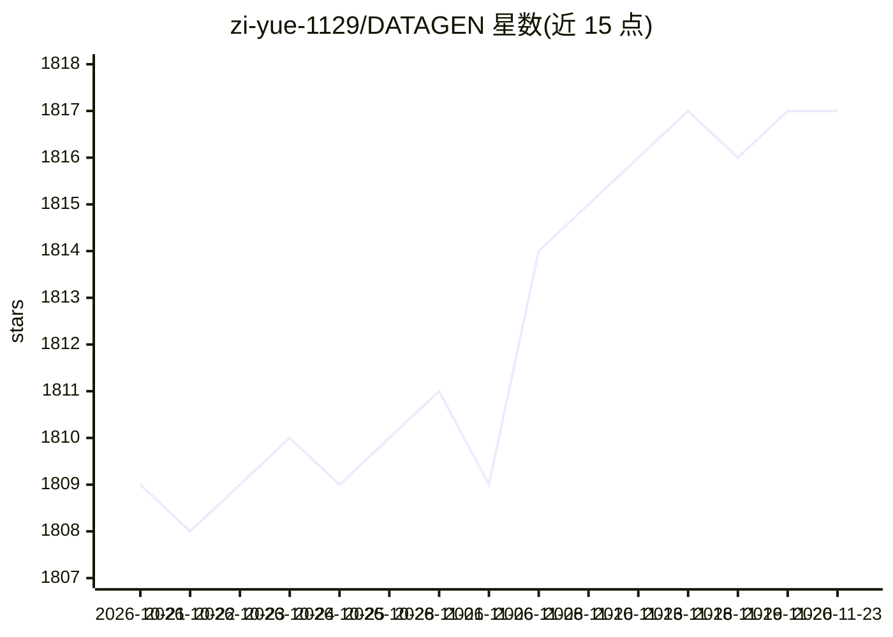

# zi-yue-1129/DATAGEN

⭐ 1,817 · Python · MIT · 推送 2026-11-16 · [GitHub](https://github.com/zi-yue-1129/DATAGEN) · 个人维护

**面向数据分析研究者的多 Agent 自动化研究助手**

基于 LangChain/LangGraph 构建的多 Agent 数据分析与研究平台，由 hypothesis、process、visualization、code、searcher、report、quality_review、note 等专用 Agent 组成，按状态图工作流执行假设生成、数据分析、可视化与报告撰写，流程中含人工确认环节。各 Agent 的模型提供商与模型可通过 agent_models.yaml 逐个配置，支持 dev/prod 配置目录切换。使用需自备 API key，运行可能消耗多次 API 调用，且系统可能修改被分析数据，README 建议先备份。

## 筛选速览

| 维度 | 判定 | 备注 |
|---|---|---|
| AI 角色 | `ai-native` | 本体是模型或模型工具 |
| 许可风险 | `permissive` | MIT |
| 部署形态 | `library` | 以包/库形式分发 |
| 模型依赖 | — | README 未给出锁定关系 |
| 硬件要求 | — | 无带数字的原话,不猜 |
| 安装摩擦 | `low` | 无编译、无系统依赖或容器化 |
| 成熟度 | — | 结构信号不足 |

## 能力要点

- 8 个专用 Agent 组成的假设→分析→报告工作流
- agent_models.yaml 按 Agent 自定义模型提供商与参数
- 支持 MCP 服务器集成（Filesystem、GitHub、Web Search）
- skills/ 目录的可复用知识与三级渐进加载配置架构

## 适用场景

- 上传 CSV 数据后自动完成分析并生成图文报告
- 让系统生成并验证研究假设后再进入分析流程
- 在 agent_models.yaml 中为不同 Agent 切换模型配置

## 场景标签

`多智能体` `数据分析` · 领域:Agent 开发

## 证据(README 行号)

> L11: DATAGEN is an advanced AI-powered data analysis and research platform that utilizes multiple specialized agents to 
> L129: - `hypothesis_agent`: Generates research hypotheses
> L140: The system uses LangGraph to create a state graph that manages the entire research process. The workflow includes 

## 星数曲线

2026-10-21 1,809 → 2026-11-23 1,817（+8）

---
*卡片 v1 · prompt 1.4 · 生成 2026-11-23 · 置信度 mid · 依据 README sha `f7cf51db697d` · [字段定义](../../DATASET.md)*
