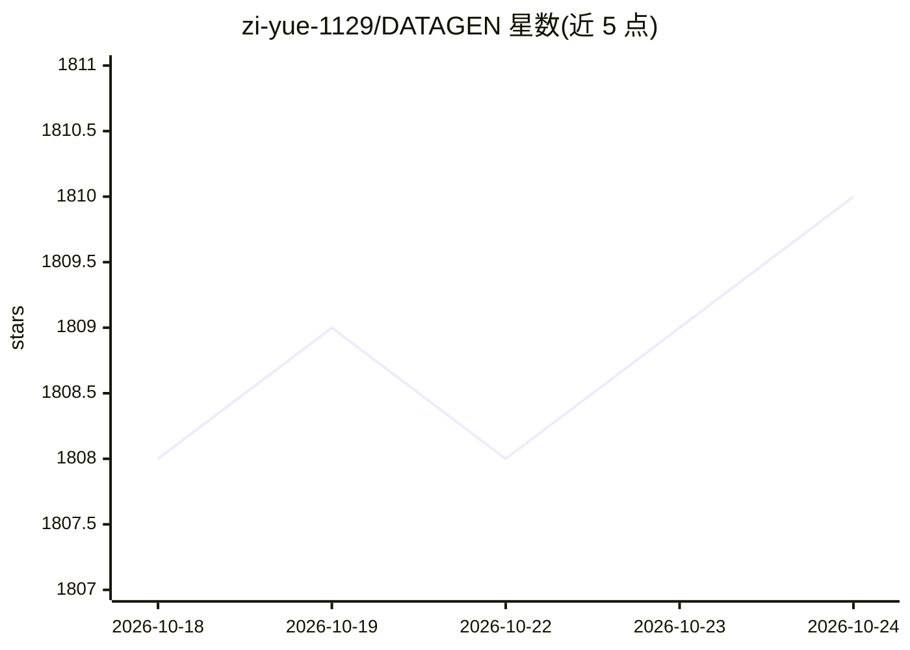

# zi-yue-1129/DATAGEN

⭐ 1,810 · Python · MIT · 推送 2026-10-14 · [GitHub](https://github.com/zi-yue-1129/DATAGEN) · 个人维护

**多 agent 数据分析与研究报告自动化平台**

基于 LangChain、LangGraph 与 OpenAI GPT 模型的多 agent 数据分析研究平台：hypothesis、process、visualization、code、searcher、report、quality_review、note 等专职 agent 通过 LangGraph 状态图协作，完成假设生成、人工确认、数据分析与可视化、文献检索、报告撰写与质量复审全流程。各 agent 的模型提供方（openai/google/anthropic/ollama/groq 等）经 agent_models.yaml 配置，支持技能模块、动态工具加载与 MCP 外部服务器集成。运行需配置 .env 与 API 额度；README 提示 agent 可能修改被分析数据，建议先备份，数据由用户运行时自行提供。

## 筛选速览

| 维度 | 判定 | 备注 |
|---|---|---|
| AI 角色 | `ai-native` | 本体是模型或模型工具 |
| 许可风险 | `permissive` | MIT |
| 部署形态 | `library` | 以包/库形式分发 |
| 模型依赖 | local-ok | 支持本地模型 |
| 硬件要求 | — | 无带数字的原话,不猜 |
| 安装摩擦 | `low` | 无编译、无系统依赖或容器化 |
| 成熟度 | — | 结构信号不足 |

## 能力要点

- 8 个专职 agent 经 LangGraph 状态图组织研究全流程（假设→分析→报告→质量复审）
- agent_models.yaml 可按 agent 分别配置模型提供方（openai/anthropic/ollama/groq 等）
- 技能架构、ToolFactory 动态工具加载与 MCP 外部服务器集成（Filesystem/GitHub/Web Search）
- Note Taker agent 记录研究过程并做上下文保留

## 适用场景

- 给我一份 CSV 数据，让系统自动生成假设、分析并产出图表化报告
- 通过多 agent 协作完成从文献检索到报告撰写的完整研究流程
- 按 agent 粒度切换不同模型提供方运行同一研究流程

## 场景标签

 · 领域:数据科学/科研自动化

## 证据(README 行号)

> L11: DATAGEN is an advanced AI-powered data analysis and research platform that utilizes multiple specialized agents to 
> L124: The system uses LangGraph to create a state graph that manages the entire research process. The workflow includes 

## 星数曲线

2026-10-18 1,808 → 2026-10-24 1,810（+2）

---
*卡片 v1 · prompt 1.4 · 生成 2026-10-21 · 置信度 mid · 依据 README sha `8a441bdce801` · [字段定义](../../DATASET.md)*
