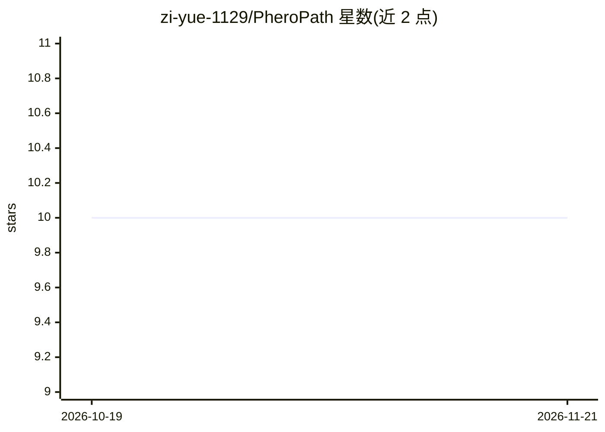

# zi-yue-1129/PheroPath

⭐ 10 · Python · MIT · 推送 2026-01-28 · [GitHub](https://github.com/zi-yue-1129/PheroPath) · 个人维护

**给 AI Agent 的文件信息素协调协议与 VS Code 可视化**

PheroPath 实现基于共识自主（stigmergy）的通信协议：Agent 与人通过扩展属性或 sidecar JSON 在文件上留 DANGER/TODO/SAFE/INSIGHT 等元数据信号，不修改文件内容本身。提供供 LLM 工具调用使用的 CLI（secrete/sniff/cleanse）与 VS Code 扩展（实时雷达面板、过滤与编辑）。信号支持随时间衰减，跨 Linux/macOS/Windows。面向使用 Claude Code、Cursor、Antigravity 等 Agent 的开发者，用于护栏约束与多 Agent 协作。MCP Server 支持标注为即将推出。

## 筛选速览

| 维度 | 判定 | 备注 |
|---|---|---|
| AI 角色 | `ai-ecosystem` | LLM/agent 周边工具 |
| 许可风险 | `permissive` | MIT |
| 部署形态 | `library` | 以包/库形式分发 |
| 模型依赖 | — | README 未给出锁定关系 |
| 硬件要求 | — | 无带数字的原话,不猜 |
| 安装摩擦 | `low` | 无编译、无系统依赖或容器化 |
| 成熟度 | — | 结构信号不足 |

## 能力要点

- 信号存储于 xattr/sidecar JSON，源码零污染
- secrete/sniff/cleanse CLI 面向 LLM 工具调用设计
- VS Code 雷达实时可视化与信号过滤/编辑
- 信号支持时间衰减，跨三平台运行

## 适用场景

- 标记不可修改的核心文件，让 Agent 写入前感知边界
- 架构 Agent 留 TODO，编码 Agent 扫描目录接手任务
- 在 VS Code 中快速审阅 Agent 留下的变更说明

## 场景标签

`多智能体` · 领域:Agent 开发

## 证据(README 行号)

> L15: **PheroPath** solves this by implementing **Digital Stigmergy**: a biological communication protocol used by ants. 
> L36: - **🔧 Agent-First Design**: CLI tools (`sniff`, `secrete`) designed specifically for LLM tool-use.
> L102: **(Coming Soon)** We are working on a native MCP Server implementation to expose pheromones directly to supported 

## 星数曲线

2026-10-19 10 → 2026-11-21 10（+0）

---
*卡片 v1 · prompt 1.4 · 生成 2026-11-19 · 置信度 mid · 依据 README sha `73633af9c26b` · [字段定义](../../DATASET.md)*
