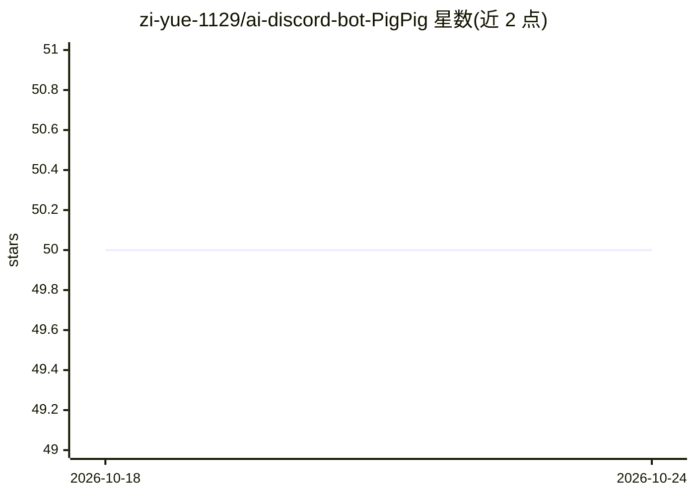

# zi-yue-1129/ai-discord-bot-PigPig

⭐ 50 · Python · MIT · 推送 2026-10-24 · [GitHub](https://github.com/zi-yue-1129/ai-discord-bot-PigPig) · [官网](https://zi-yue-1129.github.io/ai-discord-bot-PigPig/) · 个人维护 · 中文 README

**基于多模态 LLM 的 Discord 对话机器人：自然语言交互与社区功能**

以 Python 编写的 Discord 机器人，接入 LLM 提供自然语言对话，支持视觉问答（VQA）、AI 图像生成、频道对话摘要等 AI 能力；同时提供 YouTube 音乐播放、提醒、日程管理、餐厅推荐、GIF 搜索等社区功能。具备长期记忆系统（语义检索历史对话，可选用 Qdrant 向量库）、三级继承的系统提示词管理与自动更新机制。模型来源支持本地多模态模型及可选的 Anthropic/OpenAI/Gemini API key。安装需 Python 3.11+ 与 FFmpeg，通过 git clone 源码运行。

## 筛选速览

| 维度 | 判定 | 备注 |
|---|---|---|
| AI 角色 | `ai-native` | 本体是模型或模型工具 |
| 许可风险 | `permissive` | MIT |
| 部署形态 | `None` |  |
| 模型依赖 | — | README 未给出锁定关系 |
| 硬件要求 | — | 无带数字的原话,不猜 |
| 安装摩擦 | `medium` | 含编译或系统依赖之一 |
| 成熟度 | — | 结构信号不足 |

## 能力要点

- LLM 自然语言对话，支持 VQA 与 AI 图像生成
- 长期记忆系统：语义检索历史对话，可选 Qdrant 向量库
- 三级继承的每服务器/频道系统提示词定制
- 音乐播放、提醒、日程、餐厅推荐、摘要等社区功能模块

## 适用场景

- 为 Discord 社区添加可对话、能看图和生成图片的 AI 机器人
- 让机器人记住并检索频道历史对话以提供上下文
- 在服务器内听 YouTube 音乐、设提醒和管理日程

## 场景标签

`聊天机器人` `图像生成` · 领域:对话与助手

## 证据(README 行号)

> L25: * 🧠 **AI-Powered Conversations**: Utilizes advanced LLMs for natural language understanding and generation.
> L26: * 🖼️ **Multi-modal Capabilities**: Supports visual question answering (VQA) and AI image generation.

## 星数曲线

2026-10-18 50 → 2026-10-24 50（+0）

---
*卡片 v1 · prompt 1.4 · 生成 2026-10-24 · 置信度 high · 依据 README sha `f18f80568bed` · [字段定义](../../DATASET.md)*
