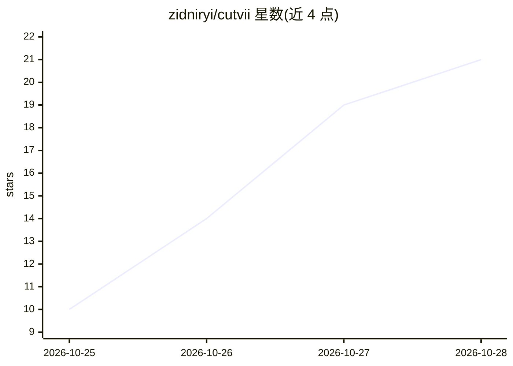

# zidniryi/cutvii

⭐ 21 · TypeScript · MIT · 推送 2026-10-23 · [GitHub](https://github.com/zidniryi/cutvii) · [官网](https://cutvii.space) · 个人维护

**离线优先的跨平台开源桌面视频编辑器，含端侧 AI 功能**

基于 Tauri（React+TypeScript 前端、Rust 后端）的开源桌面视频编辑器：导入视频/音频/图片，多轨时间线剪辑（分割、修剪、吸附、撤销重做），预览后导出 H.264/AAC MP4 或 M4A/MP3/WAV 音频。本地优先、离线运行，无账号无分析；语音模型仅在用户确认时下载。AI 功能包括自动字幕、本机文字转语音配音、AI 超分与 Auto Clips 竖屏剪辑。发布版内置 FFmpeg，macOS 构建仅支持 Apple Silicon，未签名。

## 筛选速览

| 维度 | 判定 | 备注 |
|---|---|---|
| AI 角色 | `ai-enhanced` | 去掉 AI 部分产品仍成立 |
| 许可风险 | `permissive` | MIT |
| 部署形态 | `desktop` | 安装包/桌面程序 |
| 模型依赖 | — | README 未给出锁定关系 |
| 硬件要求 | — | 无带数字的原话,不猜 |
| 安装摩擦 | `medium` | 含编译或系统依赖之一 |
| 成熟度 | — | 结构信号不足 |

## 能力要点

- 多轨时间线剪辑并导出 H.264/AAC MP4（含 ffprobe 校验）
- 端侧 AI：自动字幕、本机 TTS 配音、AI 超分、Auto Clips
- 本地优先离线运行，无账号无分析，媒体不上传
- 项目文件为版本化 JSON，支持缺失媒体检测与重链接

## 适用场景

- 离线剪辑视频并导出 MP4，不想注册账号或上传素材
- 给视频自动生成字幕或添加本机合成的配音
- 把横屏素材自动剪成竖屏短片

## 场景标签

`图像视频处理` `语音合成` `语音识别` · 领域:内容生成

## 证据(README 行号)

> L15: An open-source, cross-platform desktop video editor: **import → edit on a multi-track timeline → preview → export M
> L16: Local-first and offline: no account, no analytics, your media is never modified or uploaded. The one thing
> L35: Taken from CutVii 1.0.3 on macOS while editing a one-minute pumpkin video: titles, an on-device voice-over,

## 星数曲线

2026-10-25 10 → 2026-10-28 21（+11）

---
*卡片 v1 · prompt 1.4 · 生成 2026-10-28 · 置信度 mid · 依据 README sha `d7177f156bc6` · [字段定义](../../DATASET.md)*
