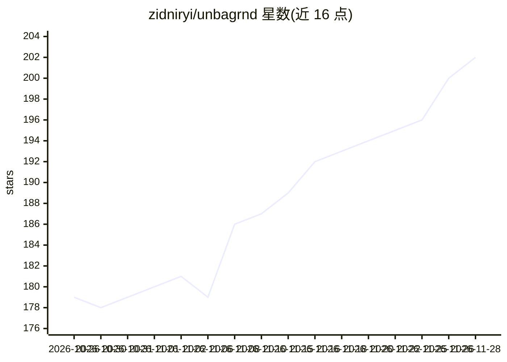

# zidniryi/unbagrnd

⭐ 202 · Rust · MIT · 推送 2026-11-27 · [GitHub](https://github.com/zidniryi/unbagrnd) · [官网](https://zidniryi.space/unbagrnd/) · 个人维护

**本地离线运行的 AI 图像背景移除桌面/安卓应用**

基于 Tauri + Rust 的跨平台抠图应用，通过 ONNX Runtime 在本机运行 IS-Net 分割模型，图像不上传、无遥测，首次下载模型后完全离线。支持单张与批量处理（统一背景色/渐变、阴影、尺寸模板、ZIP 导出）、笔刷修补、边缘收缩/羽化、alpha 蒙版导出、剪贴板输入输出，以及证件照/电商图等尺寸预设。另提供自托管 REST API（Axum + Docker），复用同一推理核心。macOS 构建仅支持 Apple Silicon，未签名需手动清除 Gatekeeper 隔离。

## 筛选速览

| 维度 | 判定 | 备注 |
|---|---|---|
| AI 角色 | `ai-native` | 本体是模型或模型工具 |
| 许可风险 | `permissive` | MIT |
| 部署形态 | `desktop` | 安装包/桌面程序 |
| 模型依赖 | — | README 未给出锁定关系 |
| 硬件要求 | — | 无带数字的原话,不猜 |
| 安装摩擦 | `low` | 无编译、无系统依赖或容器化 |
| 成熟度 | — | 结构信号不足 |

## 能力要点

- ONNX Runtime 本地推理 IS-Net 模型，无云端与遥测
- 批量处理：统一背景/阴影/尺寸模板、失败重试、ZIP 导出
- 笔刷修补与边缘 shift/smooth/feather 手工精修
- 自托管 REST API 与桌面端共用同一推理核心

## 适用场景

- 电商商品图与证件照的批量抠图与尺寸适配
- 无网络环境下本地去除图片背景
- 设计流程中导出 alpha 蒙版做图层蒙版
- 自建服务器提供图像背景移除 API

## 场景标签

`图像视频处理` · 领域:感知与多模态

## 证据(README 行号)

> L14: A small desktop app that uses AI to remove the background from images —
> L18: - **On-device AI.** Background removal runs through a real neural network
> L249: A self-hosted REST API wrapping the exact same on-device background-removal

## 星数曲线

2026-10-26 179 → 2026-11-28 202（+23）

---
*卡片 v1 · prompt 1.4 · 生成 2026-11-28 · 置信度 mid · 依据 README sha `ff84fbcb105e` · [字段定义](../../DATASET.md)*
