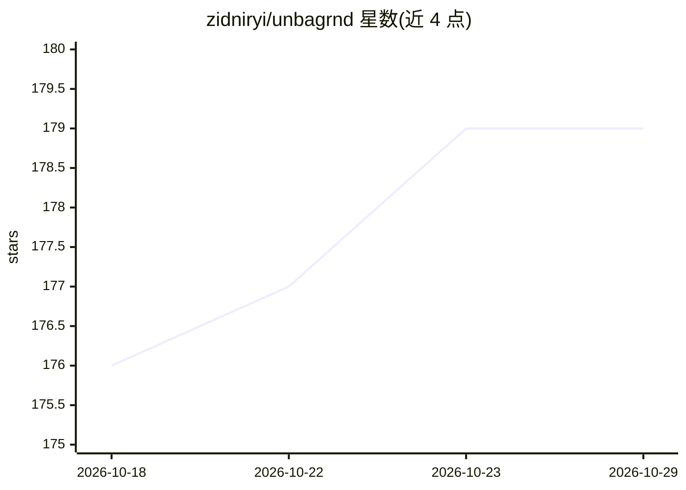

# zidniryi/unbagrnd

⭐ 179 · Rust · MIT · 推送 2026-10-14 · [GitHub](https://github.com/zidniryi/unbagrnd) · [官网](https://zidniryi.space/unbagrnd/) · 个人维护

**跨平台本地 AI 抠图工具：设备端去除图片背景**

面向 macOS/Windows/Linux/Android 的开源抠图应用：基于 ONNX Runtime 在本地运行 IS-Net 等多种背景去除模型，模型首次使用时下载并缓存，此后完全离线，无云端 API、账号与遥测。功能覆盖单图与文件夹批量处理、画笔手动修补、边缘收缩/平滑/羽化、导出 alpha 蒙版、PNG/WebP/SVG 输出。另附带自托管 REST API，复用同一推理核心，支持 API key 管理与批量接口，通过 Docker Compose 部署。macOS 版仅支持 Apple Silicon，构建未做代码签名需手动清除隔离属性。

## 筛选速览

| 维度 | 判定 | 备注 |
|---|---|---|
| AI 角色 | `ai-native` | 本体是模型或模型工具 |
| 许可风险 | `permissive` | MIT |
| 部署形态 | `desktop` | 安装包/桌面程序 |
| 模型依赖 | — | README 未给出锁定关系 |
| 硬件要求 | — | 无带数字的原话,不猜 |
| 安装摩擦 | `low` | 无编译、无系统依赖或容器化 |
| 成熟度 | — | 结构信号不足 |

## 能力要点

- 设备端 ONNX Runtime 推理，模型一次下载后完全离线
- 可选多种抠图模型（默认约 43 MB 起），权衡速度与精度
- 批量处理含统一背景/投影、命名模板、失败重试与 ZIP 导出
- 自托管 REST API 复用同一推理核心，含 API key 管理与批量端点

## 适用场景

- 本地离线给照片去背景，不上传图片
- 批量处理整个文件夹并导出带透明通道的结果
- 自建服务通过 REST API 为应用提供抠图能力

## 场景标签

`图像视频处理` · 领域:感知与多模态

## 证据(README 行号)

> L14: A small desktop app that uses AI to remove the background from images —
> L18: - **On-device AI.** Background removal runs through a real neural network
> L78: unbagrnd runs IS-Net "general use"

## 星数曲线

2026-10-18 176 → 2026-10-29 179（+3）

---
*卡片 v1 · prompt 1.4 · 生成 2026-10-22 · 置信度 mid · 依据 README sha `ce7df1bdb3b1` · [字段定义](../../DATASET.md)*
