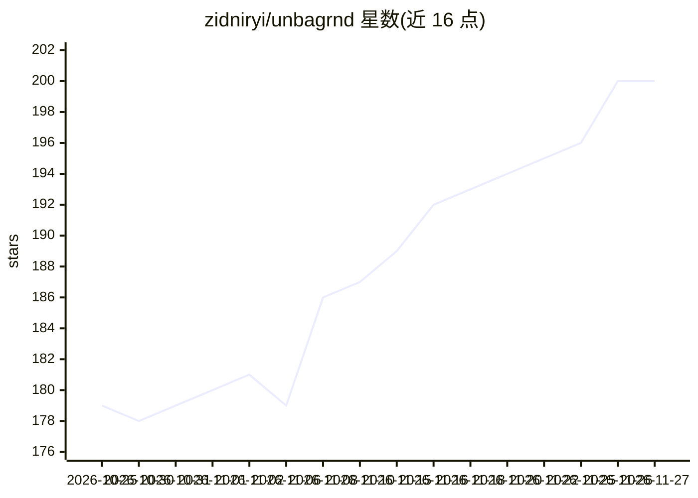

# zidniryi/unbagrnd

⭐ 200 · Rust · MIT · 推送 2026-11-09 · [GitHub](https://github.com/zidniryi/unbagrnd) · [官网](https://zidniryi.space/unbagrnd/) · 个人维护

**开源本地 AI 抠图应用：离线去除图片背景，附自托管 API**

跨平台桌面与 Android 应用，通过 ONNX Runtime 在本地运行 IS-Net 分割模型去除图片背景，首次使用一次性下载模型（默认约 43–170 MB）后完全离线。支持单张与批量处理、笔刷手动修整、边缘收缩/羽化、背景填充与阴影、裁剪与尺寸预设（电商方图、证件照、社交媒体）、导出 PNG/WebP/SVG 及 alpha 蒙版。另提供自托管 REST API（Docker 部署，含 API key 管理与速率限制）。MIT 许可，无账号与遥测。

## 筛选速览

| 维度 | 判定 | 备注 |
|---|---|---|
| AI 角色 | `ai-native` | 本体是模型或模型工具 |
| 许可风险 | `permissive` | MIT |
| 部署形态 | `desktop` | 安装包/桌面程序 |
| 模型依赖 | — | README 未给出锁定关系 |
| 硬件要求 | — | 无带数字的原话,不猜 |
| 安装摩擦 | `low` | 无编译、无系统依赖或容器化 |
| 成熟度 | — | 结构信号不足 |

## 能力要点

- 本地 ONNX 运行 IS-Net 模型，安装后完全离线推理
- 批量处理：统一背景/阴影/命名模板、失败重试、ZIP 导出
- 笔刷与边缘修整、alpha 蒙版导出、尺寸与证件照预设
- 自托管 REST API，Docker 一键部署，含 key 管理与限流

## 适用场景

- 批量给商品图/证件照换底色并按预设尺寸导出
- 无网络或注重隐私环境下本地处理截图与人像抠图
- 自托管 API 批量给应用接入背景去除能力
- 导出 alpha 蒙版供设计工具做图层蒙版

## 场景标签

`图像视频处理` · 领域:感知与多模态

## 证据(README 行号)

> L14: A small desktop app that uses AI to remove the background from images —
> L90: unbagrnd runs IS-Net "general use"
> L92: Segmentation"*, ECCV 2022) as an ONNX model, via the `ort`

## 星数曲线

2026-10-25 179 → 2026-11-27 200（+21）

---
*卡片 v1 · prompt 1.4 · 生成 2026-11-25 · 置信度 mid · 依据 README sha `40910357341d` · [字段定义](../../DATASET.md)*
