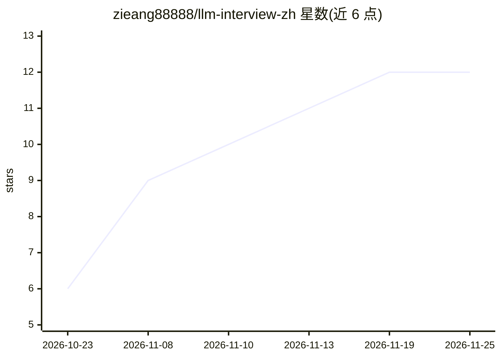

# zieang88888/llm-interview-zh

⭐ 12 · MIT · 推送 2026-10-05 · [GitHub](https://github.com/zieang88888/llm-interview-zh) · 个人维护 · 中文 README

**面向算法岗求职者的中文大模型面试题库（100+ 问）**

纯 Markdown 的中文大模型面试题库，按 10 大主题组织 100+ 道题，覆盖 Transformer、RLHF、RAG、微调、量化与推理部署、Agent、Prompt 工程、Tokenization、多模态与场景手撕。每题附 3-6 条答案要点与 1-3 个追问点，并按【基础】【进阶】【实战】三级难度标注，附带面试前不同时间段的复习建议。无代码安装环节，打开 Markdown 文件即可使用。

## 筛选速览

| 维度 | 判定 | 备注 |
|---|---|---|
| AI 角色 | `ai-knowledge` | 知识聚合/清单类 |
| 许可风险 | `permissive` | MIT |
| 部署形态 | `None` |  |
| 模型依赖 | — | README 未给出锁定关系 |
| 硬件要求 | — | 无带数字的原话,不猜 |
| 安装摩擦 | `low` | 无编译、无系统依赖或容器化 |
| 成熟度 | — | 结构信号不足 |

## 能力要点

- 10 大主题、100+ 题，含追问点设计
- 三级难度分级：基础/进阶/实战
- 答案要点控制在 3-6 条，纯 Markdown 格式

## 适用场景

- 面试前按主题和难度分级刷大模型八股题
- 对照目标岗位方向复习 RAG/Agent/微调等专题
- 收藏为日常大模型知识速查手册

## 场景标签

`教程课程` · 领域:学习与行业

## 证据(README 行号)

> L9: `llm-interview-zh` 是一份**纯 Markdown 的中文大模型面试题库**：打开就能背、按主题分文件、答案精简准确。
> L21: ## 速查索引（想刷哪块 → 打开哪篇）

## 星数曲线

2026-10-23 6 → 2026-11-25 12（+6）

---
*卡片 v1 · prompt 1.4 · 生成 2026-11-18 · 置信度 high · 依据 README sha `de2834b39c43` · [字段定义](../../DATASET.md)*
