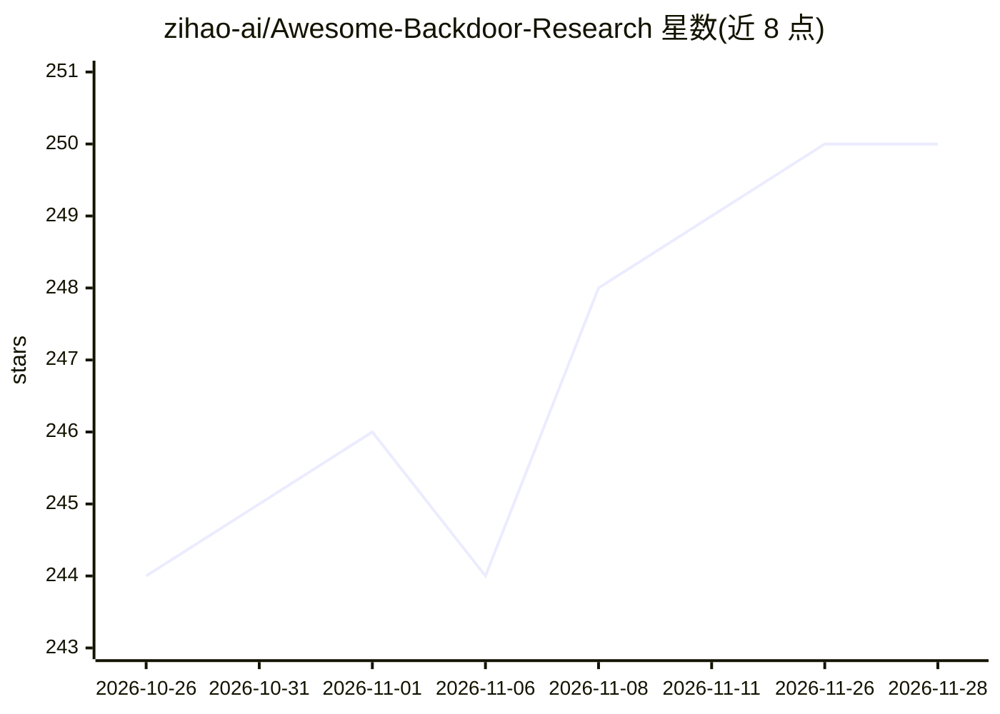

# zihao-ai/Awesome-Backdoor-Research

⭐ 250 · Python · GPL-3.0 · 推送 2026-11-25 · [GitHub](https://github.com/zihao-ai/Awesome-Backdoor-Research) · 个人维护

**AI 后门攻击与防御研究论文策展清单（928 篇，12 类）**

以 awesome 清单形式收录 AI 安全领域的后门攻击与防御研究资源：928 篇论文按计算机视觉、NLP、多模态、生成模型、AI 智能体、具身智能、联邦学习、图学习、强化学习、语音等 12 个研究方向与 39 个子类组织，每张表格按年份倒序列出条目，标注论文类型（Attack/Defense/Analysis/Survey/Benchmark/Dataset 等）并附代码链接（如有）。另设教程、课程、workshop 与工具箱栏目，各领域起始处提供综述引导阅读。

## 筛选速览

| 维度 | 判定 | 备注 |
|---|---|---|
| AI 角色 | `ai-knowledge` | 知识聚合/清单类 |
| 许可风险 | `viral` | GPL-3.0 |
| 部署形态 | `None` |  |
| 模型依赖 | — | README 未给出锁定关系 |
| 硬件要求 | — | 无带数字的原话,不猜 |
| 安装摩擦 | `low` | 无编译、无系统依赖或容器化 |
| 成熟度 | — | 结构信号不足 |

## 能力要点

- 928 篇论文、12 个研究方向、39 个子类目的结构化表格
- 覆盖从视觉/语言模型到 AI 智能体、具身智能的后门研究
- 每篇标注 Attack/Defense/Survey/Benchmark 等类型并附代码链接
- 附带教程、课程、workshop 与工具箱栏目

## 适用场景

- 查找某个研究方向（如联邦学习后门、LLM Agent 后门）的相关论文
- 通过综述快速了解后门攻击与防御领域全貌
- 为安全研究选题定位 benchmark 与数据集论文
- 查找论文对应的开源实现

## 场景标签

`精选清单` `教程课程` `网络安全` · 领域:学习与行业

## 证据(README 行号)

> L13: ## 📚 Papers
> L15: **928 Papers · 12 Categories · 39 Subcategories**
> L17: Start with surveys for an overview, or browse a research area and its subcategories. Each table lists papers from n

## 星数曲线

2026-10-26 244 → 2026-11-28 250（+6）

---
*卡片 v1 · prompt 1.4 · 生成 2026-11-27 · 置信度 high · 依据 README sha `92d68cda3d70` · [字段定义](../../DATASET.md)*
