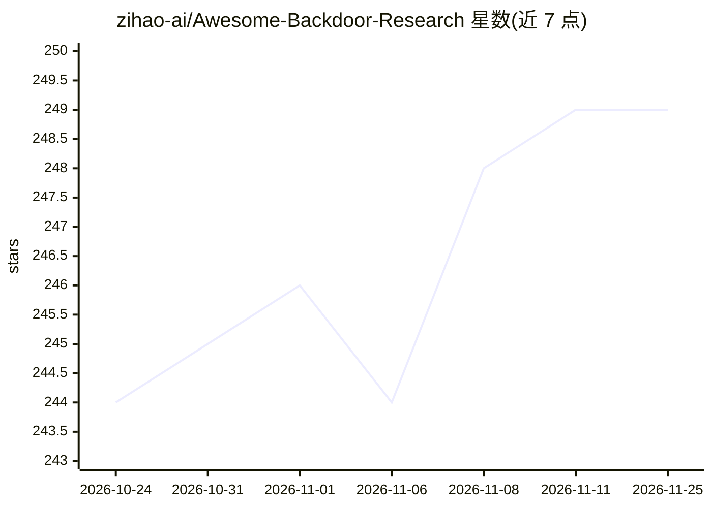

# zihao-ai/Awesome-Backdoor-Research

⭐ 249 · Python · GPL-3.0 · 推送 2026-11-01 · [GitHub](https://github.com/zihao-ai/Awesome-Backdoor-Research) · 个人维护

**AI 后门攻击与防御研究论文资源清单（896 篇）**

面向 AI 安全研究者的论文聚合清单：收录 896 篇后门攻击与防御相关论文，按 12 个研究领域、39 个子类别组织，覆盖视觉、语言模型、AI Agent、生成模型、具身智能、图学习、联邦学习等方向；每篇标注年份、发表venue、类型（Attack/Defense/Analysis/Application/Survey/Benchmark/Dataset）及代码链接；另含教程、课程、workshop 与工具箱资源入口，建议从 22 篇综述入手浏览。

## 筛选速览

| 维度 | 判定 | 备注 |
|---|---|---|
| AI 角色 | `ai-knowledge` | 知识聚合/清单类 |
| 许可风险 | `viral` | GPL-3.0 |
| 部署形态 | `None` |  |
| 模型依赖 | — | README 未给出锁定关系 |
| 硬件要求 | — | 无带数字的原话,不猜 |
| 安装摩擦 | `low` | 无编译、无系统依赖或容器化 |
| 成熟度 | — | 结构信号不足 |

## 能力要点

- 896 篇论文、12 类别、39 子类别的结构化目录
- 每篇标注论文类型与代码实现链接
- 覆盖 LLM Agent 技能/记忆后门等新攻击面
- 附带教程、课程、workshop 与工具箱栏目

## 适用场景

- 查找后门攻击/防御方向的研究切入点与综述
- 为新方法寻找同领域 baseline 论文与开源实现
- 调研 AI Agent 与 LLM 供应链中的后门威胁

## 场景标签

`精选清单` · 领域:学习与行业

## 证据(README 行号)

> L1: Awesome Backdoor Research — backdoor attacks, defenses, and research resources across AI
> L15: **896 Papers · 12 Categories · 39 Subcategories**
> L17: Start with surveys for an overview, or browse a research area and its subcategories. Each table lists papers from n

## 星数曲线

2026-10-24 244 → 2026-11-25 249（+5）

---
*卡片 v1 · prompt 1.4 · 生成 2026-11-25 · 置信度 high · 依据 README sha `e59f109d9e32` · [字段定义](../../DATASET.md)*
