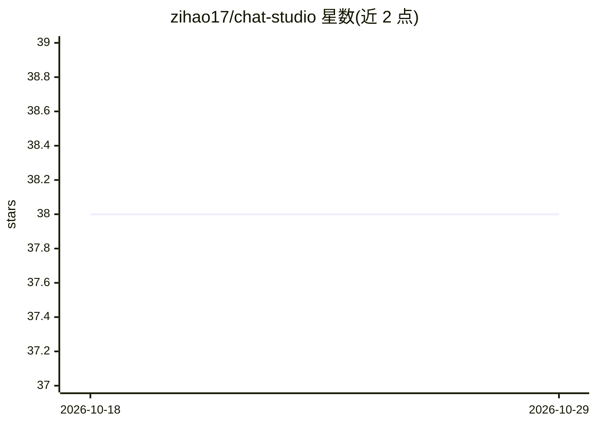

# zihao17/chat-studio

⭐ 38 · TypeScript · 推送 2026-04-17 · [GitHub](https://github.com/zihao17/chat-studio) · [官网](http://8.130.174.186/) · 个人维护 · 中文 README

**开源 AI 对话平台：多会话聊天、知识库 RAG 与工作流**

面向终端用户的开源 AI 对话 Web 应用：前端 React 19 + TypeScript + Vite，后端 Node.js + Express，数据库 SQLite，认证用 JWT。提供多会话并发聊天、流式输出、Markdown 渲染、文件上传解析、Temperature/Top_P 调节等；知识库模块支持文档上传、向量入库、BM25+向量混合检索、Qwen3-Rerank 重排与引用溯源；另有用户注册登录与云端同步。工作流功能标注为开发中。安装方式为 git clone 源码后本地运行，环境要求 Node.js ≥18、pnpm ≥8。

## 筛选速览

| 维度 | 判定 | 备注 |
|---|---|---|
| AI 角色 | `ai-native` | 本体是模型或模型工具 |
| 许可风险 | `none` | — |
| 部署形态 | `None` |  |
| 模型依赖 | — | README 未给出锁定关系 |
| 硬件要求 | — | 无带数字的原话,不猜 |
| 安装摩擦 | `low` | 无编译、无系统依赖或容器化 |
| 成熟度 | `idea` | |

## 能力要点

- 多会话并发聊天，流式输出与 Markdown/代码高亮渲染
- 知识库 RAG：混合检索（BM25+向量）+ Qwen3-Rerank 重排 + 引用溯源
- 支持 Qwen3、ChatGPT、DeepSeek、GLM 等模型实时切换
- 用户系统与对话历史云端同步

## 适用场景

- 自部署一个支持知识库问答的 AI 聊天站点
- 把个人文档建成知识库，聊天时获得带引用的回答
- 多会话并行使用不同 AI 模型对话

## 场景标签

`聊天机器人` `文档问答` · 领域:对话与助手

## 证据(README 行号)

> L28: **Chat Studio：** 一个开源的 AI 对话平台，支持多会话并发、知识库增强与自动化工作流。前端基于 React + TypeScript 构建，后端采用 Node.js。
> L45:  - **AI 集成** ：支持 Qwen3、ChatGPT、DeepSeek、GLM 等多个 AI 模型，支持模型实时切换
> L77:  - **RAG 对话增强** ：聊天时可开启 RAG 模式并选择知识库，AI 自动检索相关文档片段作为上下文，生成更准确、更具针对性的回答

## 星数曲线

2026-10-18 38 → 2026-10-29 38（+0）

---
*卡片 v1 · prompt 1.4 · 生成 2026-10-25 · 置信度 high · 依据 README sha `2ac6e451e9ff` · [字段定义](../../DATASET.md)*
