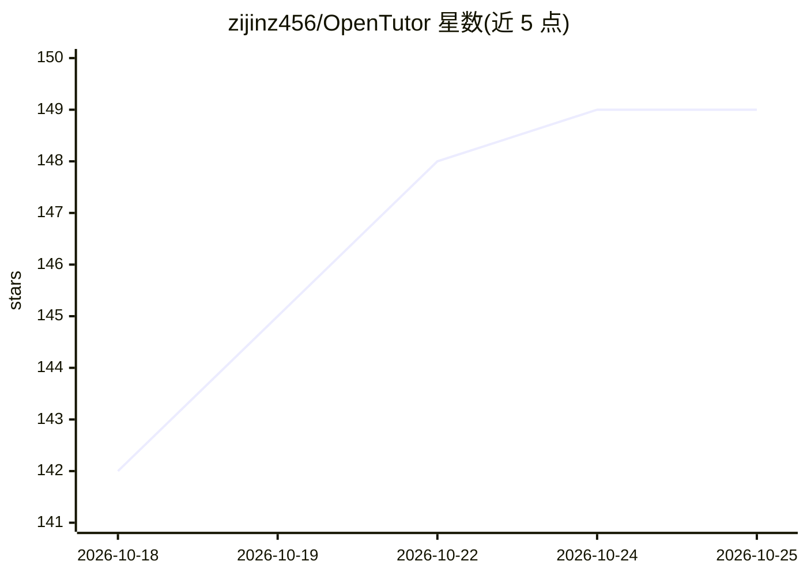

# zijinz456/OpenTutor

⭐ 148 · Python · MIT · 推送 2026-10-25 · [GitHub](https://github.com/zijinz456/OpenTutor) · 个人维护 · 中文 README

**本地自托管的自适应 AI 学习平台：上传材料生成笔记与测验**

面向学习者的自托管、本地优先 AI 学习平台：上传 PDF/DOCX/PPTX 或接入 Canvas LMS 后，自动生成结构化笔记、抽认卡和测验，并提供带来源引用的 AI 导师对话、学习计划日历与 FSRS 4.5 间隔复习。工作区由 12 个可组合学习块构成，AI 依据行为信号（疲劳检测、错误模式）调整深度与难度。默认使用 Ollama 本地模型，也支持 OpenAI/Anthropic/DeepSeek 等 10+ 提供商。以 Docker Compose 或脚本部署，SQLite 存储，当前为本地单用户公开测试版。

## 筛选速览

| 维度 | 判定 | 备注 |
|---|---|---|
| AI 角色 | `ai-native` | 本体是模型或模型工具 |
| 许可风险 | `permissive` | MIT |
| 部署形态 | `self-host` | docker 或自建部署 |
| 模型依赖 | local-ok | 支持本地模型 |
| 硬件要求 | — | 无带数字的原话,不猜 |
| 安装摩擦 | `low` | 无编译、无系统依赖或容器化 |
| 成熟度 | `idea` | |

## 能力要点

- 上传材料 30 秒生成笔记、抽认卡与 7 种题型的测验
- 带来源引用的 AI 导师，按行为信号自适应调整深度
- FSRS 4.5 间隔复习与知识图谱（LOOM/LECTOR，实验性）
- 默认 Ollama 本地运行，支持 10+ LLM 提供商切换

## 适用场景

- 把自己的课程资料变成笔记、测验和抽认卡来复习
- 本地运行 AI 导师，数据不出机器
- 按间隔复习计划跟踪薄弱知识点

## 场景标签

`知识库管理` `文档问答` · 领域:知识与检索

## 证据(README 行号)

> L25: OpenTutor is a **self-hosted, local-first** AI learning platform. Upload your course material, and within 30 second
> L154: Local-first with Ollama by default. Switch to OpenAI, Anthropic, DeepSeek, Gemini, Groq, vLLM, LM Studio, OpenRout

## 星数曲线

2026-10-18 142 → 2026-10-25 149（+7）

---
*卡片 v1 · prompt 1.4 · 生成 2026-10-22 · 置信度 mid · 依据 README sha `3ad2b767ca29` · [字段定义](../../DATASET.md)*
