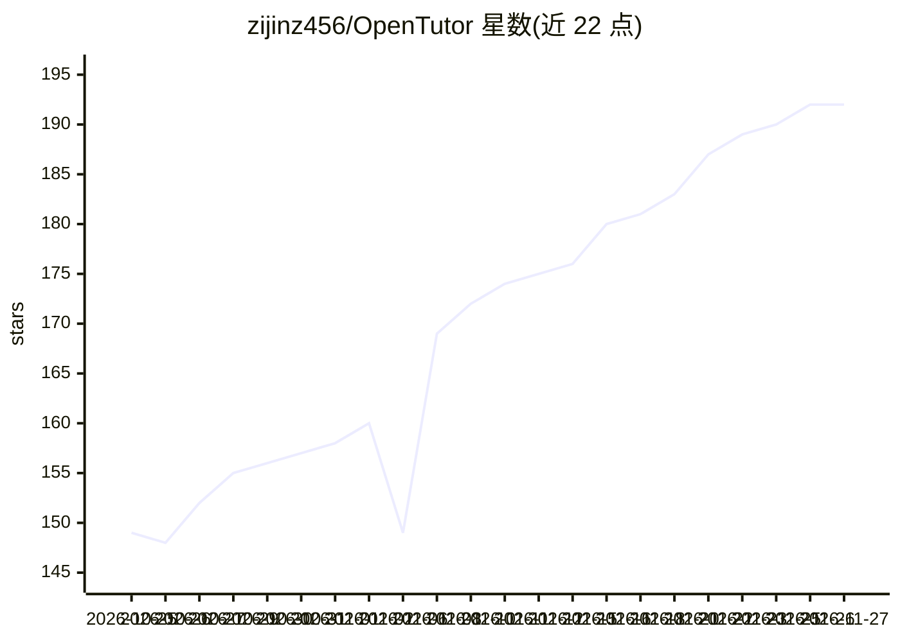

# zijinz456/OpenTutor

⭐ 192 · Python · MIT · 推送 2026-11-26 · [GitHub](https://github.com/zijinz456/OpenTutor) · 个人维护

**本地自托管的 AI 自适应学习工作台，从课件生成笔记/测验/卡片**

自托管、本地优先的 AI 学习平台：上传 PDF/DOCX/PPTX 或对接 Canvas LMS，自动生成结构化笔记、闪卡、7 种题型的测验，并提供带来源引用的自适应 AI 导师。基于块式可组合工作区（12 种学习块），内置 FSRS 4.5 间隔重复、知识图谱（LOOM）与认知负荷检测。默认走本地 Ollama 无需 API key，支持 10+ LLM 提供商。当前为本地单用户公测，多用户/课堂模式不在范围内；效果依赖本地运行时与硬件。

## 筛选速览

| 维度 | 判定 | 备注 |
|---|---|---|
| AI 角色 | `ai-native` | 本体是模型或模型工具 |
| 许可风险 | `permissive` | MIT |
| 部署形态 | `self-host` | docker 或自建部署 |
| 模型依赖 | local-ok | 支持本地模型 |
| 硬件要求 | — | 无带数字的原话,不猜 |
| 安装摩擦 | `low` | 无编译、无系统依赖或容器化 |
| 成熟度 | `idea` | |

## 能力要点

- 12 种可组合学习块，工作区按学习行为自适应调整布局
- AI 导师回答带来源引用，支持苏格拉底提问模式
- FSRS 4.5 间隔重复 + LOOM 知识图谱 + LECTOR 语义复习（实验性）
- 默认 Ollama 本地推理，可切换 OpenAI/DeepSeek/vLLM 等 10+ 提供商

## 适用场景

- 把课程 PDF 上传后自动生成笔记、闪卡和测验来复习
- 用 AI 导师针对自己的课件提问并获得带出处解答
- 借助知识图谱和间隔重复安排长期学习计划

## 场景标签

`知识库管理` `知识图谱` `文档问答` · 领域:知识与检索

## 证据(README 行号)

> L25: OpenTutor is a **self-hosted, local-first** AI learning platform. Upload your course material, and within 30 second
> L120: ### AI Tutor with Source Citations
> L158: Local-first with Ollama by default. Switch to OpenAI, Anthropic, DeepSeek, Gemini, Groq, vLLM, LM Studio, OpenRout

## 星数曲线

2026-10-25 149 → 2026-11-27 192（+43）

---
*卡片 v1 · prompt 1.4 · 生成 2026-11-26 · 置信度 mid · 依据 README sha `8ee5a2879ff3` · [字段定义](../../DATASET.md)*
