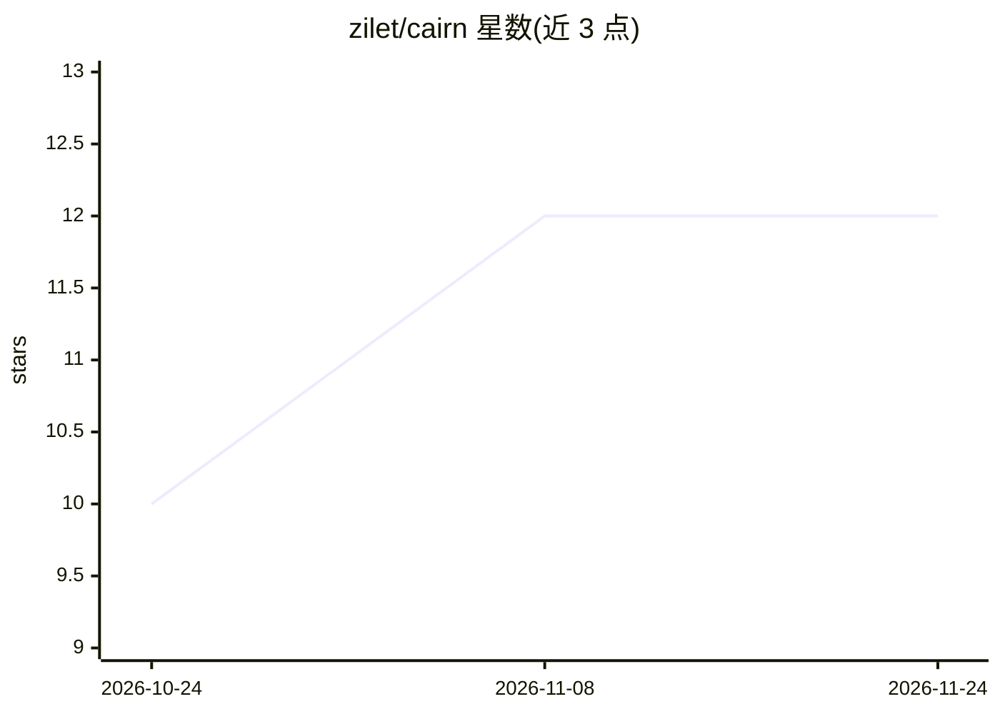

# zilet/cairn

⭐ 12 · TypeScript · MIT · 推送 2026-11-23 · [GitHub](https://github.com/zilet/cairn) · [官网](https://codespaces.new/zilet/cairn) · 个人维护

**自托管健康教练系统：整合训练/饮食/睡眠/体检数据给出每日建议**

自托管个人健康系统：单 Node 服务同时提供 PWA、REST API、MCP server（300+ 工具）与后台调度器，数据存于本地 SQLite 文件。系统读取力量训练、跑步、饮食、睡眠与体检数据生成每日 Brief（休息/轻松/训练建议），并配备教练团队自动执行带一键撤销的有界变更。AI 模型部分由用户在设置中接入自有订阅（Claude、ChatGPT、Google 或 Grok）完成，产品本体提供数据整合与建议流程。支持 Railway 云部署或本机 Docker/Podman 运行，可跑在树莓派上。

## 筛选速览

| 维度 | 判定 | 备注 |
|---|---|---|
| AI 角色 | `ai-enhanced` | 去掉 AI 部分产品仍成立 |
| 许可风险 | `permissive` | MIT |
| 部署形态 | `self-host` | docker 或自建部署 |
| 模型依赖 | — | README 未给出锁定关系 |
| 硬件要求 | — | 无带数字的原话,不猜 |
| 安装摩擦 | `low` | 无编译、无系统依赖或容器化 |
| 成熟度 | — | 结构信号不足 |

## 能力要点

- 单 Node 服务集成 PWA、REST API、MCP server（300+ 工具）与调度器
- 数据存于用户自有 SQLite 文件，支持 Docker/Podman/Railway 部署
- Garmin 双向同步：睡眠/HRV 进入，力量训练导出为手表活动
- 体检标记指标可传播至饮食与训练建议，并生成就诊资料包

## 适用场景

- 把训练、饮食、睡眠与体检数据整合为一幅完整图景
- 自托管部署，用自有 AI 订阅驱动每日恢复/训练建议
- 自动做出可撤销的训练与营养调整
- 整理临床排序的资料包带去就诊

## 场景标签

`AI 助手` · 领域:对话与助手

## 证据(README 行号)

> L41: Pair a device** (a one-time code); your access token is your recovery key. Then connect your own AI
> L156: - **Agent-native.** A full MCP server (300+ tools) ships alongside the PWA, so any MCP client can
> L160: One Node service serves the PWA (`/`), the REST API (`/api/*`), the MCP server (`/mcp`), and a

## 星数曲线

2026-10-24 10 → 2026-11-24 12（+2）

---
*卡片 v1 · prompt 1.4 · 生成 2026-11-18 · 置信度 high · 依据 README sha `38de060914e8` · [字段定义](../../DATASET.md)*
