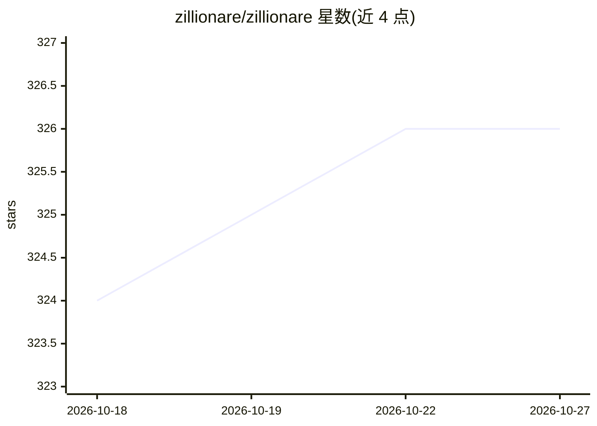

# zillionare/zillionare

⭐ 326 · Python · 推送 2026-10-26 · [GitHub](https://github.com/zillionare/zillionare) · [官网](http://ke.quantide.cn) · 组织维护 · 中文 README

**量化投资研究与 Python 量化实战的博客文章聚合站**

匡醍量化（大富翁量化）维护的量化投资内容仓库：以表格形式聚合最新文章标题、日期与摘要，主题覆盖对冲基金动态、程序化监管、因子投资 FAQ、因子预处理与因子检验教程等，正站位于 quantide.cn，另提及公众号与 ke.quantide.cn 教程资源。仓库本体不提供代码安装或运行方式，仅作为内容索引。

## 筛选速览

| 维度 | 判定 | 备注 |
|---|---|---|
| AI 角色 | `ai-knowledge` | 知识聚合/清单类 |
| 许可风险 | `none` | — |
| 部署形态 | `None` |  |
| 模型依赖 | — | README 未给出锁定关系 |
| 硬件要求 | — | 无带数字的原话,不猜 |
| 安装摩擦 | `low` | 无编译、无系统依赖或容器化 |
| 成熟度 | — | 结构信号不足 |

## 能力要点

- 聚合量化投资研究文章的标题/日期/摘要列表
- 因子投资、因子预处理、因子检验系列 FAQ 教程
- 覆盖对冲基金、程序化监管等市场动态摘要

## 适用场景

- 跟踪量化投资领域的最新文章与市场动态
- 学习因子投资与因子检验的入门 FAQ
- 通过正站与公众号获取 Python 量化实战教程

## 场景标签

`金融量化` `教程课程` · 领域:学习与行业

## 证据(README 行号)

> L1: # 匡醍量化 | 大富翁量化
> L3: > 专注量化投资研究与 Python 量化交易实战。
> L9: |封面|标题 / 日期 / 摘要|

## 星数曲线

2026-10-18 324 → 2026-10-27 326（+2）

---
*卡片 v1 · prompt 1.4 · 生成 2026-10-21 · 置信度 high · 依据 README sha `cde77ac3e52c` · [字段定义](../../DATASET.md)*
