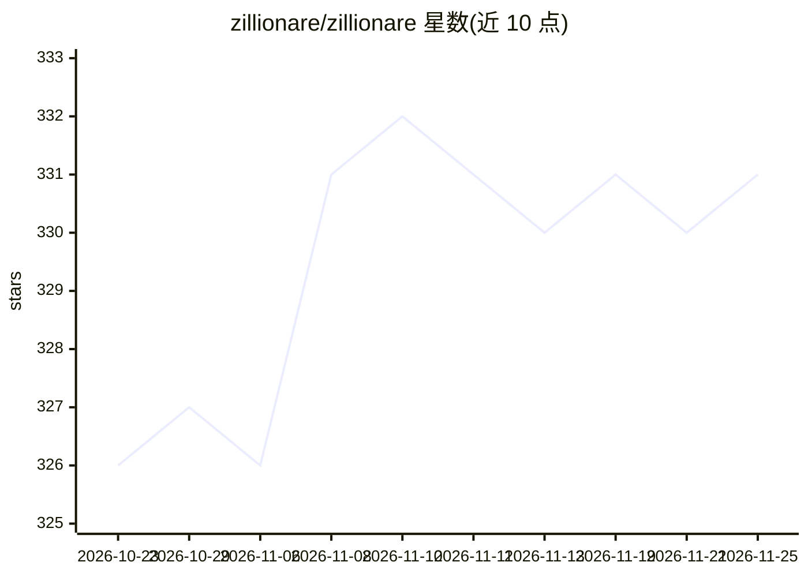

# zillionare/zillionare

⭐ 331 · Python · 推送 2026-11-18 · [GitHub](https://github.com/zillionare/zillionare) · [官网](http://ke.quantide.cn) · 组织维护 · 中文 README

**面向量化投资学习者的中文量化教程与文章索引仓库**

该仓库本身是一份文章索引：列出发布在 quantide.cn 的量化投资研究文章，主题包括夏普比率与风险指标、无风险利率、回测陷阱、数据源工程、对冲基金行业动态及 AI 量化交易系统拆解等，文章示例中使用 akshare 等 Python 工具。仓库不包含可运行的代码模块或安装说明，定位为引导读者访问博客站与公众号获取量化教程和资源。

## 筛选速览

| 维度 | 判定 | 备注 |
|---|---|---|
| AI 角色 | `ai-knowledge` | 知识聚合/清单类 |
| 许可风险 | `none` | — |
| 部署形态 | `None` |  |
| 模型依赖 | — | README 未给出锁定关系 |
| 硬件要求 | — | 无带数字的原话,不猜 |
| 安装摩擦 | `low` | 无编译、无系统依赖或容器化 |
| 成熟度 | — | 结构信号不足 |

## 能力要点

- 以表格形式索引量化投资主题文章（风险指标、回测、数据源等）
- 提供博客正站与公众号入口（Quantide）
- 文章内容涉及 akshare 演示、Parquet/DuckDB 存储等技术主题

## 适用场景

- 查找 A 股量化回测与风险指标的中文教程
- 了解量化数据源与本地存储的实践文章
- 跟踪对冲基金行业与 AI 量化系统的中文解读

## 场景标签

`金融量化` `教程课程` · 领域:学习与行业

## 证据(README 行号)

> L3: > 专注量化投资研究与 Python 量化交易实战。
> L9: |封面|标题 / 日期 / 摘要|

## 星数曲线

2026-10-23 326 → 2026-11-25 331（+5）

---
*卡片 v1 · prompt 1.4 · 生成 2026-11-25 · 置信度 high · 依据 README sha `12e60b639d9c` · [字段定义](../../DATASET.md)*
