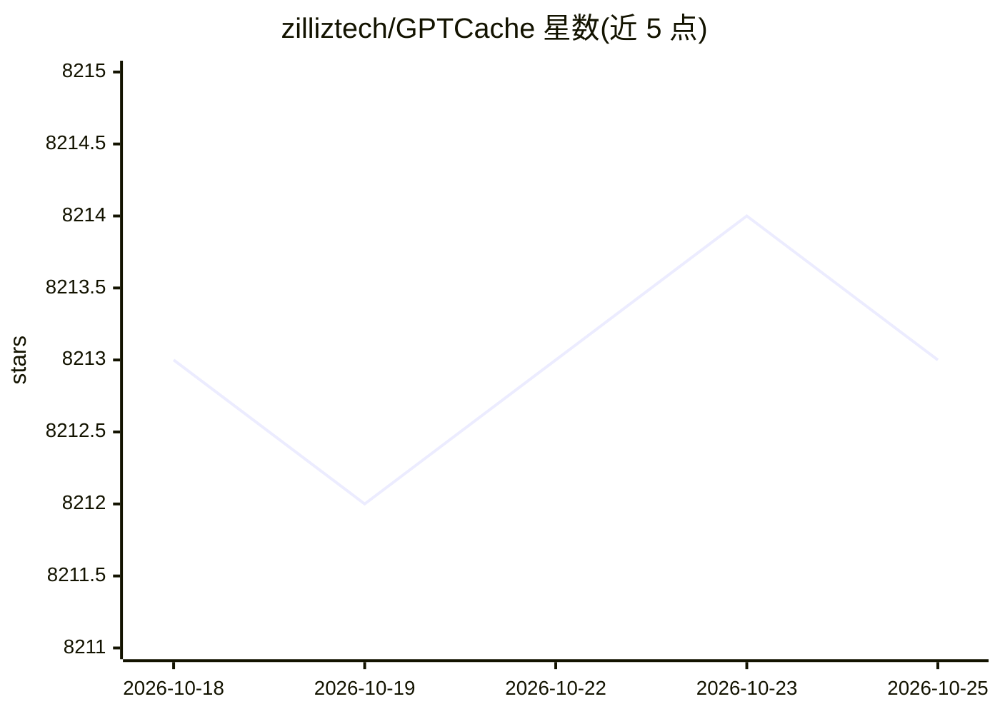

# zilliztech/GPTCache

⭐ 8,215 · Python · MIT · 推送 2026-09-22 · [GitHub](https://github.com/zilliztech/GPTCache) · [官网](https://gptcache.readthedocs.io) · 组织维护

**为开发者给 LLM 查询做语义缓存的 Python 库**

面向 LLM 应用开发者的语义缓存库：将查询转为 embedding 存入向量存储，相似查询命中缓存时直接返回已存回答，减少 LLM API 请求次数与费用并降低延迟。采用模块化设计：LLM/多模态适配层（支持 OpenAI、langchain、Llamacpp 等）、embedding 生成器（OpenAI/ONNX/Hugging Face/Cohere 等）、缓存存储（SQLite/PostgreSQL/MySQL 等）。支持 temperature 参数控制跳过缓存概率。限制：README 声明不再为新 API 或模型添加支持，鼓励使用 get/set API；仓库处于快速开发期，API 可能随时变动。提供 Docker server 镜像供任意语言使用。

## 筛选速览

| 维度 | 判定 | 备注 |
|---|---|---|
| AI 角色 | `ai-ecosystem` | LLM/agent 周边工具 |
| 许可风险 | `permissive` | MIT |
| 部署形态 | `library` | 以包/库形式分发 |
| 模型依赖 | — | README 未给出锁定关系 |
| 硬件要求 | — | 无带数字的原话,不猜 |
| 安装摩擦 | `low` | 无编译、无系统依赖或容器化 |
| 成熟度 | `idea` | |

## 能力要点

- 基于 embedding 相似度检索的语义缓存，支持精确匹配与相似匹配
- 模块化设计：LLM 适配器、embedding 生成器、向量存储、缓存存储均可替换
- 多后端缓存存储支持（SQLite/PostgreSQL/MySQL/DynamoDB 等）
- 发布 Docker server 镜像，任意语言可通过服务方式使用

## 适用场景

- 降低高流量 LLM 应用的 API 调用费用与响应延迟
- 开发测试期用缓存/模拟数据替代真实 LLM API 连接
- 缓解 LLM 服务速率限制带来的可用性问题

## 场景标签

`语义搜索` · 领域:知识与检索

## 证据(README 行号)

> L27: To tackle this challenge, we have created GPTCache, a project dedicated to building a semantic cache for storing LL
> L159: GPTCache employs embedding algorithms to convert queries into embeddings and uses a vector store for similarity se

## 星数曲线

2026-10-18 8,213 → 2026-10-25 8,213（+0）

---
*卡片 v1 · prompt 1.4 · 生成 2026-10-20 · 置信度 high · 依据 README sha `ba873236657c` · [字段定义](../../DATASET.md)*
