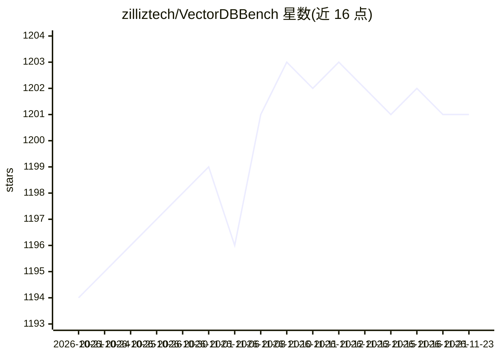

# zilliztech/VectorDBBench

⭐ 1,201 · Python · MIT · 推送 2026-11-18 · [GitHub](https://github.com/zilliztech/VectorDBBench) · [官网](https://zilliz.com/vector-database-benchmark-tool) · 组织维护 · 中文 README

**面向开发者的向量数据库性能与性价比基准测试工具**

VDBBench 是一个向量数据库基准测试工具，除提供主流数据库与云服务的基准结果外，允许用户自行复现结果或测试新系统。它为插入、向量搜索、过滤搜索和全文搜索提供可复现的工作负载，注册数据集涵盖 SIFT、GIST、Cohere Wikipedia、OpenAI C4 嵌入及托管在 Hugging Face 的多模态数据集。提供 Web 可视化界面（init_bench）与 vectordbbench 命令行两种运行方式，针对云服务生成性价比报告。要求 Python ≥ 3.11，默认安装仅含 PyMilvus 客户端，其余数据库客户端通过 extras 按需安装。

## 筛选速览

| 维度 | 判定 | 备注 |
|---|---|---|
| AI 角色 | `ai-ecosystem` | LLM/agent 周边工具 |
| 许可风险 | `permissive` | MIT |
| 部署形态 | `library` | 以包/库形式分发 |
| 模型依赖 | — | README 未给出锁定关系 |
| 硬件要求 | — | 无带数字的原话,不猜 |
| 安装摩擦 | `low` | 无编译、无系统依赖或容器化 |
| 成熟度 | — | 结构信号不足 |

## 能力要点

- 支持插入、向量搜索、过滤搜索、全文搜索的可复现工作负载
- 提供 Web 界面（init_bench）与 vectordbbench CLI 两种运行方式
- 注册数据集覆盖不同语料规模、维度、模态、距离度量与查询分布
- 通过 pip extras 支持数十种数据库客户端按需安装

## 适用场景

- 在自建集群上复现向量数据库排行榜的测试用例
- 对比不同云向量服务在真实负载下的性价比
- 用 Hugging Face 托管数据集测试新接入的向量数据库
- 以命令行参数化方式批量运行性能与召回测试

## 场景标签

`模型评测` · 领域:评测与运维

## 证据(README 行号)

> L7: VDBBench is not just an offering of benchmark results for mainstream vector databases and cloud services, it's your 
> L12: VectorDBBench provides repeatable workloads for insertion, vector search,
> L57: pip install vectordb-bench

## 星数曲线

2026-10-21 1,194 → 2026-11-23 1,201（+7）

---
*卡片 v1 · prompt 1.4 · 生成 2026-11-23 · 置信度 high · 依据 README sha `df42648f6d0d` · [字段定义](../../DATASET.md)*
