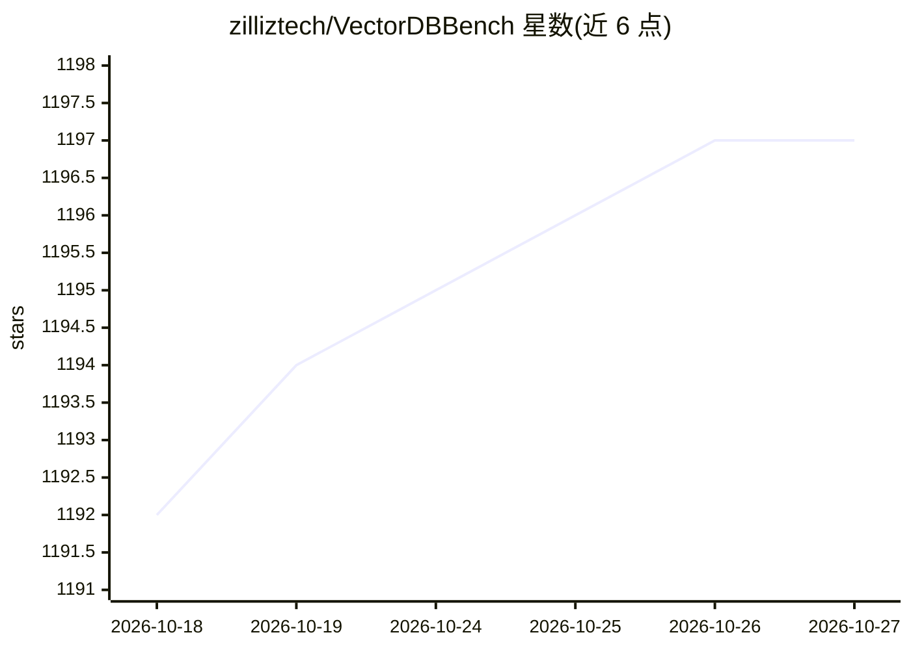

# zilliztech/VectorDBBench

⭐ 1,197 · Python · MIT · 推送 2026-10-08 · [GitHub](https://github.com/zilliztech/VectorDBBench) · [官网](https://zilliz.com/vector-database-benchmark-tool) · 组织维护

**向量数据库性能与成本效益基准测试工具**

由 Zilliz 维护的向量数据库基准测试工具，覆盖 20 余种开源向量库与云服务（Milvus、Qdrant、Pinecone、Weaviate、Elastic、pgvector 系、Redis、MongoDB 等），提供可重复的插入、向量搜索、过滤搜索与 BM25 全文搜索工作负载；内置数据集涵盖 SIFT/GIST、Cohere/OpenAI 嵌入及 Hugging Face 上的 VIBE 多模态数据集。提供可视化界面 init_bench 与 CLI 两种运行方式，输出 QPS、时延、召回率及云服务成本效益报告。需 Python 3.11 以上，按后端安装对应 extras。

## 筛选速览

| 维度 | 判定 | 备注 |
|---|---|---|
| AI 角色 | `ai-ecosystem` | LLM/agent 周边工具 |
| 许可风险 | `permissive` | MIT |
| 部署形态 | `library` | 以包/库形式分发 |
| 模型依赖 | — | README 未给出锁定关系 |
| 硬件要求 | — | 无带数字的原话,不猜 |
| 安装摩擦 | `low` | 无编译、无系统依赖或容器化 |
| 成熟度 | — | 结构信号不足 |

## 能力要点

- 支持 20 余种向量数据库后端的可重复基准测试
- 覆盖插入、向量搜索、过滤搜索与 BM25 全文搜索负载
- 注册数据集含 SIFT/GIST、Cohere/OpenAI 嵌入与 Hugging Face 多模态数据集
- 提供可视化界面与 CLI 两种运行方式，输出成本效益报告

## 适用场景

- 选型时对比多个向量数据库或云服务的性能
- 复现公开榜单结果或测试自有部署
- 评估云服务在真实工作负载下的成本效益

## 场景标签

 · 领域:数据库/评测工具

## 证据(README 行号)

> L6: ## What is VDBBench
> L12: VectorDBBench provides repeatable workloads for insertion, vector search,

## 星数曲线

2026-10-18 1,192 → 2026-10-27 1,197（+5）

---
*卡片 v1 · prompt 1.4 · 生成 2026-10-21 · 置信度 high · 依据 README sha `16f4d93e92a0` · [字段定义](../../DATASET.md)*
