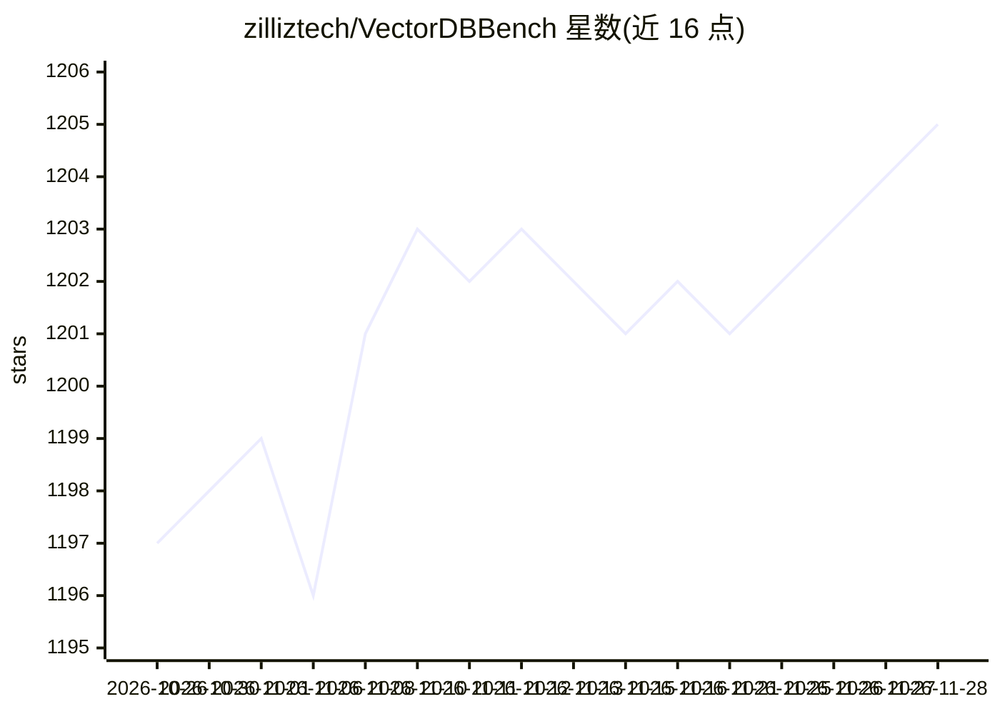

# zilliztech/VectorDBBench

⭐ 1,205 · Python · MIT · 推送 2026-11-26 · [GitHub](https://github.com/zilliztech/VectorDBBench) · [官网](https://zilliz.com/vector-database-benchmark-tool) · 组织维护

**向量数据库性能与性价比基准测试工具**

VDBBench 是一个向量数据库基准测试工具，用户可通过可视化界面或 CLI 对多种向量数据库和云服务发起可复现的插入、向量搜索、过滤搜索与全文搜索基准测试，并查看对比报告与云服务性价比报告。内置 SIFT、GIST、Cohere Wikipedia、OpenAI C4 嵌入及 Hugging Face 上的 VIBE/VDBBench 多模态数据集，覆盖不同语料规模、维度与距离度量。依赖 Python ≥3.11，默认仅含 PyMilvus 客户端，其余数据库客户端按 extras 选装。

## 筛选速览

| 维度 | 判定 | 备注 |
|---|---|---|
| AI 角色 | `ai-ecosystem` | LLM/agent 周边工具 |
| 许可风险 | `permissive` | MIT |
| 部署形态 | `library` | 以包/库形式分发 |
| 模型依赖 | — | README 未给出锁定关系 |
| 硬件要求 | — | 无带数字的原话,不猜 |
| 安装摩擦 | `low` | 无编译、无系统依赖或容器化 |
| 成熟度 | — | 结构信号不足 |

## 能力要点

- 提供可视化界面发起基准并查看对比结果报告
- 支持插入、向量搜索、过滤搜索与全文搜索（BM25 风格）基准负载
- 内置多组注册数据集：SIFT、GIST、Cohere、OpenAI 嵌入、VIBE 等多模态数据
- 通过 pip extras 选装 30 余种数据库客户端

## 适用场景

- 在多个开源向量数据库间做性能与成本对比选型
- 在自己的集群上复现排行榜基准结果
- 测试自建或新上线向量数据库系统的插入与查询性能

## 场景标签

`模型评测` · 领域:评测与运维

## 证据(README 行号)

> L7: VDBBench is not just an offering of benchmark results for mainstream vector databases and cloud services, it's your 
> L12: VectorDBBench provides repeatable workloads for insertion, vector search,

## 星数曲线

2026-10-26 1,197 → 2026-11-28 1,205（+8）

---
*卡片 v1 · prompt 1.4 · 生成 2026-11-27 · 置信度 high · 依据 README sha `a3304500c59f` · [字段定义](../../DATASET.md)*
