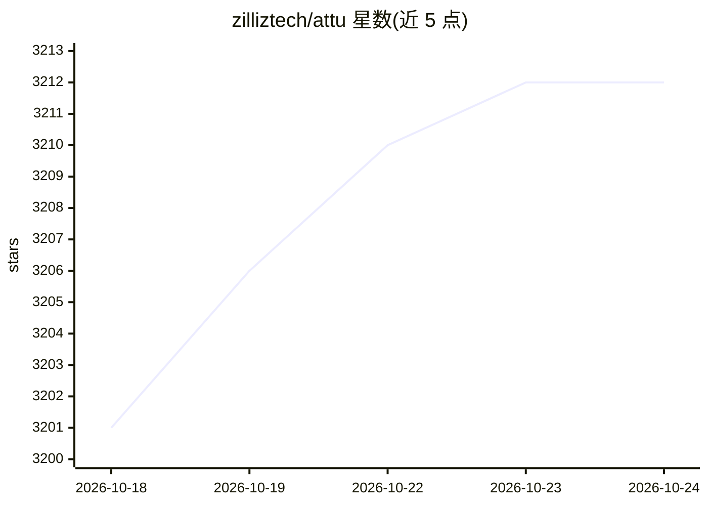

# zilliztech/attu

⭐ 3,213 · Shell · NOASSERTION · 推送 2026-09-24 · [GitHub](https://github.com/zilliztech/attu) · [官网](https://github.com/zilliztech/attu) · 组织维护 · 中文 README

**Milvus 向量数据库的图形化管理与监控工作台**

由 Zilliz 维护的 Milvus 向量数据库管理工具，支持同时连接多个 Milvus/Zilliz Cloud 集群，提供数据浏览与编辑、向量/BM25 检索、Schema 演进、备份恢复（S3/MinIO/GCS/Azure Blob）、Prometheus 指标监控、RBAC、审计日志等功能，并内置基于 50+ 工具的对话式 AI Agent 管理集群。以 Web 应用（Docker/K8s/独立服务器包）或桌面应用（macOS/Linux/Windows）分发；v3.0 兼容 Milvus 2.6.0+ 与 3.x，2.5.x 及更早版本不支持。

## 筛选速览

| 维度 | 判定 | 备注 |
|---|---|---|
| AI 角色 | `ai-ecosystem` | LLM/agent 周边工具 |
| 许可风险 | `none` | NOASSERTION |
| 部署形态 | `desktop` | 安装包/桌面程序 |
| 模型依赖 | locked-api |  |
| 硬件要求 | — | 无带数字的原话,不猜 |
| 安装摩擦 | `low` | 无编译、无系统依赖或容器化 |
| 成熟度 | — | 结构信号不足 |

## 能力要点

- 单实例连接并管理多个 Milvus 集群
- 对话式 AI Agent（50+ 工具）通过自然语言管理 Milvus
- 完整/增量备份，支持 S3、MinIO、GCS、Azure Blob
- 桌面应用覆盖 macOS/Linux/Windows，服务端有非 Docker 的 Linux x64 包

## 适用场景

- 可视化管理 Milvus 集群的集合、数据与索引
- 通过对话让 AI Agent 建集合、跑查询、分析性能
- 在 dev/staging/生产环境间切换并监控集群健康

## 场景标签

`向量数据库` · 领域:知识与检索

## 证据(README 行号)

> L8: Attu is an AI-native management tool for Milvus vector databases. Connect to multiple Milvus clusters from a single 
> L118: Chat-driven Milvus management with 50+ tools. Create collections, run queries, manage users, and analyze performan

## 星数曲线

2026-10-18 3,201 → 2026-10-24 3,212（+11）

---
*卡片 v1 · prompt 1.4 · 生成 2026-10-20 · 置信度 high · 依据 README sha `14d7293b8fb1` · [字段定义](../../DATASET.md)*
