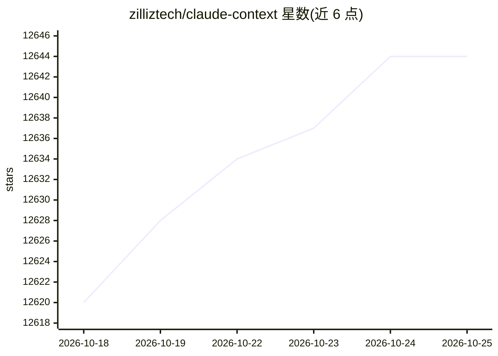

# zilliztech/claude-context

⭐ 12,646 · TypeScript · MIT · 推送 2026-07-14 · [GitHub](https://github.com/zilliztech/claude-context) · [官网](https://github.com/zilliztech/claude-context/tree/master/docs) · 组织维护

**为 AI 编码 agent 提供全代码库语义检索的 MCP 插件**

Claude Context 是一个 MCP 插件，为 Claude Code、Codex CLI、Gemini CLI、Cursor 等 AI 编码助手提供语义代码搜索：将代码库存入向量数据库（Milvus/Zilliz Cloud），支持 BM25+稠密向量混合检索，用 Merkle 树做增量索引，用 AST 做代码分块。需要 OpenAI API Key 作为 embedding 模型及向量数据库账号方可运行。以 npm 包提供（core 与 mcp 两个包），另有 VS Code 扩展形态。

## 筛选速览

| 维度 | 判定 | 备注 |
|---|---|---|
| AI 角色 | `ai-ecosystem` | LLM/agent 周边工具 |
| 许可风险 | `permissive` | MIT |
| 部署形态 | `library` | 以包/库形式分发 |
| 模型依赖 | local-ok | 支持本地模型 |
| 硬件要求 | — | 无带数字的原话,不猜 |
| 安装摩擦 | `low` | 无编译、无系统依赖或容器化 |
| 成熟度 | — | 结构信号不足 |

## 能力要点

- BM25 + 稠密向量混合代码搜索，面向自然语言查询
- Merkle 树增量重索引，仅处理变更文件
- AST 感知代码分块，支持 14 种语言
- core 包可独立用于构建应用，支持 OpenAI/VoyageAI/Ollama/Gemini embedding

## 适用场景

- 让 Claude Code 等 agent 在大型代码库中直接检索相关代码作为上下文
- 降低大代码库场景下 agent 的 token 消耗
- 在 VS Code 中进行语义代码搜索与导航

## 场景标签

`RAG` `语义搜索` · 领域:知识与检索

## 证据(README 行号)

> L16: **Claude Context** is an MCP plugin that adds semantic code search to Claude Code and other AI coding agents, givin
> L374: - **`@zilliz/claude-context-mcp`**: Model Context Protocol server for AI agent integration
> L378: - **Embedding Providers**: OpenAI, VoyageAI, Ollama, Gemini

## 星数曲线

2026-10-18 12,620 → 2026-10-25 12,644（+24）

---
*卡片 v1 · prompt 1.4 · 生成 2026-10-20 · 置信度 high · 依据 README sha `c36671501a74` · [字段定义](../../DATASET.md)*
