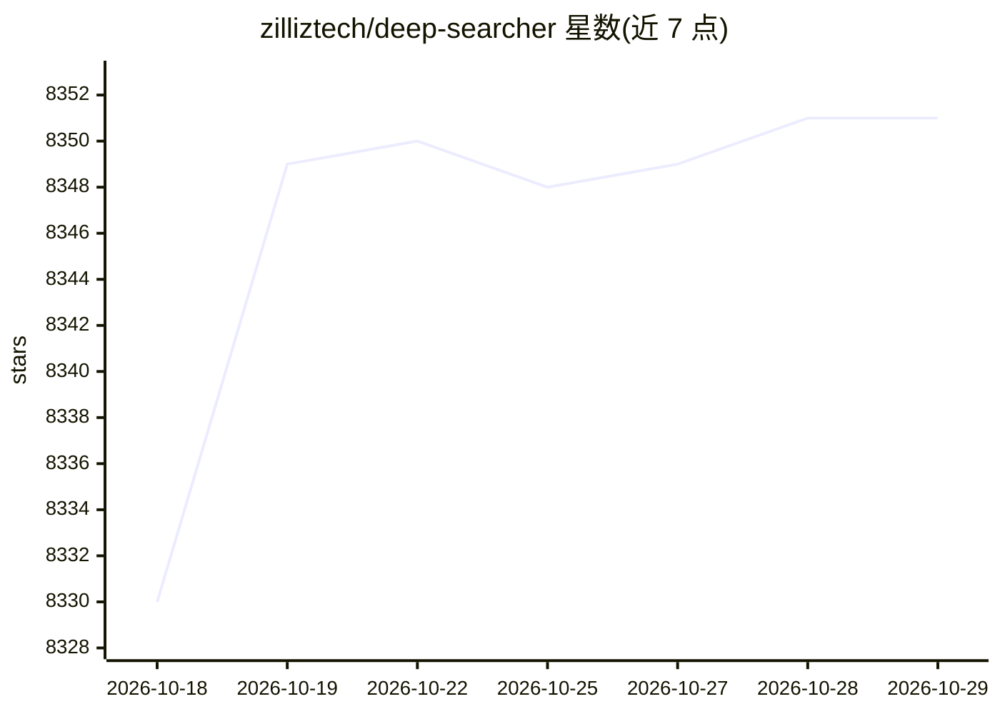

# zilliztech/deep-searcher

⭐ 8,351 · Python · Apache-2.0 · 推送 2026-09-22 · [GitHub](https://github.com/zilliztech/deep-searcher) · [官网](https://zilliztech.github.io/deep-searcher/) · 组织维护

**面向私有数据的深度搜索 RAG 框架，产出回答与报告**

由 Zilliz 维护的开源深度搜索框架：结合多种 LLM 与向量数据库（Milvus、Zilliz Cloud 等）对私有数据执行搜索、评估与推理，输出回答与综合报告。以 Python 库（pip）形式提供，通过配置对象切换 LLM、嵌入模型与向量库；LLM 支持 DeepSeek、OpenAI、XAI、Anthropic、Ollama（可选依赖）等十余家供应商，嵌入模型支持 Milvus 内置、OpenAI、Voyage 等多种来源；文档加载当前支持本地文件，网页抓取功能标注为开发中。README 自述适用于企业知识管理、智能问答与信息检索场景。

## 筛选速览

| 维度 | 判定 | 备注 |
|---|---|---|
| AI 角色 | `ai-ecosystem` | LLM/agent 周边工具 |
| 许可风险 | `permissive` | Apache-2.0 |
| 部署形态 | `library` | 以包/库形式分发 |
| 模型依赖 | local-ok | 支持本地模型 |
| 硬件要求 | — | 无带数字的原话,不猜 |
| 安装摩擦 | `low` | 无编译、无系统依赖或容器化 |
| 成熟度 | — | 结构信号不足 |

## 能力要点

- 对私有数据执行搜索-评估-推理并生成回答与报告
- 支持 Milvus 等向量数据库，可做数据分区检索
- LLM 可切换十余家供应商（DeepSeek/OpenAI/Ollama/Bedrock 等），嵌入模型同样可配置
- 本地文件加载已支持，网页抓取功能开发中

## 适用场景

- 在企业内部知识库上构建带推理的深度问答
- 私有数据场景下的信息检索与报告生成
- 结合本地 Ollama 模型搭建离线 RAG 检索系统

## 场景标签

`RAG` · 领域:知识与检索

## 证据(README 行号)

> L8: DeepSearcher combines cutting-edge LLMs (OpenAI o3, Qwen3, DeepSeek, Grok 4, Claude 4 Sonnet, Llama 4, QwQ, etc.) an
> L72: <pre><code>config.set_provider_config("llm", "(LLMName)", "(Arguments dict)")</code></pre>
> L73:  The "LLMName" can be one of the following: ["DeepSeek", "OpenAI", "XAI", "SiliconFlow", "Aliyun", "PPIO", "Togethe

## 星数曲线

2026-10-18 8,330 → 2026-10-29 8,351（+21）

---
*卡片 v1 · prompt 1.4 · 生成 2026-10-20 · 置信度 high · 依据 README sha `3d8a3abed725` · [字段定义](../../DATASET.md)*
