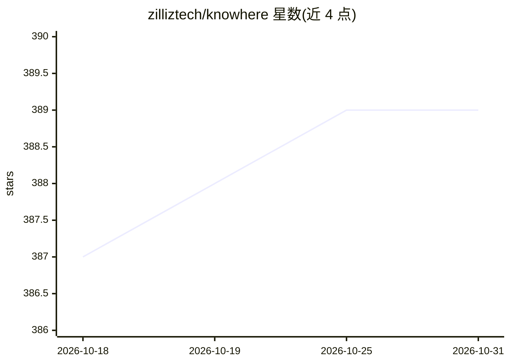

# zilliztech/knowhere

⭐ 389 · C++ · Apache-2.0 · 推送 2026-10-30 · [GitHub](https://github.com/zilliztech/knowhere) · [官网](https://github.com/milvus-io/milvus) · 组织维护

**Milvus 内部向量检索引擎核心库，集成多种索引算法**

C++ 编写的独立向量检索引擎，作为 Milvus 的内部核心，集成 FAISS、HNSW、DiskANN 等索引算法，提供最近邻搜索能力。可随 Milvus 主项目隐式构建，也可独立从源码编译；通过 scripts/install_deps.sh 安装依赖，顶层 Makefile 统一构建 CPU/GPU 版本与单元测试。支持构建 manylinux Python wheel（需 swig 与 python3-dev）。验证平台覆盖 Ubuntu 20.04/22.04（x86_64/Aarch64）与 macOS（x86_64/Apple Silicon）。面向需要在 Milvus 之外使用或修改其检索核心的开发者。

## 筛选速览

| 维度 | 判定 | 备注 |
|---|---|---|
| AI 角色 | `ai-ecosystem` | LLM/agent 周边工具 |
| 许可风险 | `permissive` | Apache-2.0 |
| 部署形态 | `library` | 以包/库形式分发 |
| 模型依赖 | — | README 未给出锁定关系 |
| 硬件要求 | — | 无带数字的原话,不猜 |
| 安装摩擦 | `low` | 无编译、无系统依赖或容器化 |
| 成熟度 | — | 结构信号不足 |

## 能力要点

- C++ 向量检索引擎，作为 Milvus 内部核心独立成库
- 集成 FAISS、HNSW、DiskANN 等索引算法
- Makefile 统一构建接口，支持 CPU/GPU 与单元测试
- 可构建 manylinux Python wheel 并以 pip 安装

## 适用场景

- 为向量数据库 Milvus 贡献或修改底层检索核心
- 脱离 Milvus 单独编译使用向量检索能力
- 通过 Python wheel 在 Python 环境中使用该检索库

## 场景标签

`向量数据库` · 领域:知识与检索

## 证据(README 行号)

> L7: Knowhere is written in C++. It is an independent project that act as Milvus's internal core.
> L11: If you wish to only use Knowhere within Milvus without changing any of the Knowhere source code, we suggest that yo

## 星数曲线

2026-10-18 387 → 2026-10-31 389（+2）

---
*卡片 v1 · prompt 1.4 · 生成 2026-10-21 · 置信度 high · 依据 README sha `8dde90ac9644` · [字段定义](../../DATASET.md)*
