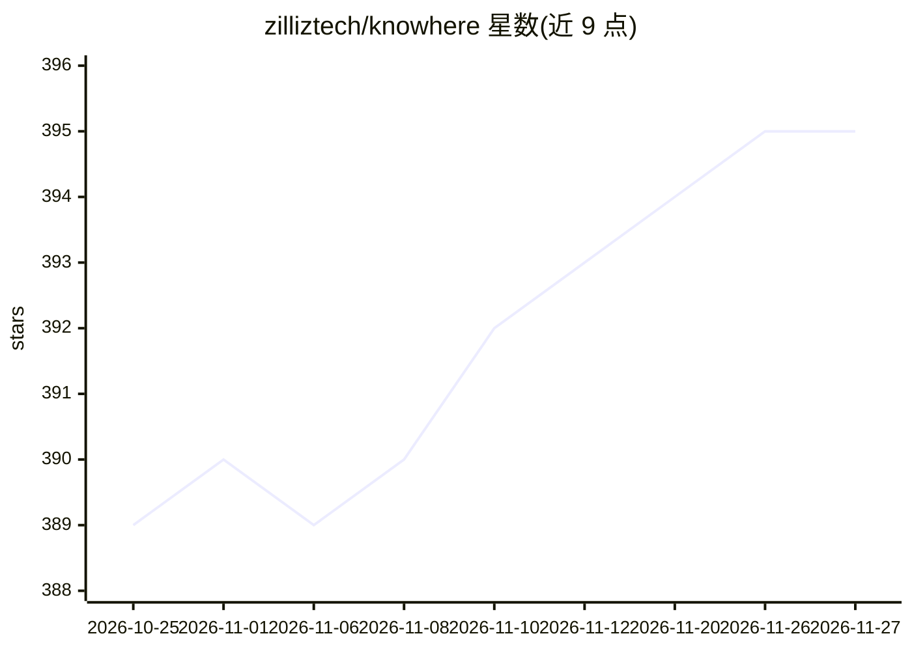

# zilliztech/knowhere

⭐ 395 · C++ · Apache-2.0 · 推送 2026-11-25 · [GitHub](https://github.com/zilliztech/knowhere) · [官网](https://github.com/milvus-io/milvus) · 组织维护

**Milvus 内核向量搜索引擎，供开发者集成与构建**

C++ 编写的向量搜索库，作为 Milvus 的内部核心，集成 FAISS、HNSW、DiskANN 等索引实现。README 提供从源码构建的完整流程：依赖安装脚本、Makefile 统一构建接口、CPU/GPU（CUDA/cuVS/Cardinal）编译选项、单元测试与 wheel 打包；另提供可选的 C ABI 与 Java 11 JNI 绑定。主要面向参与 Milvus 生态或需要独立构建该库的开发者，文档以构建与测试为主，未包含独立部署使用指南。

## 筛选速览

| 维度 | 判定 | 备注 |
|---|---|---|
| AI 角色 | `ai-native` | 本体是模型或模型工具 |
| 许可风险 | `permissive` | Apache-2.0 |
| 部署形态 | `library` | 以包/库形式分发 |
| 模型依赖 | — | README 未给出锁定关系 |
| 硬件要求 | — | 无带数字的原话,不猜 |
| 安装摩擦 | `high` | 编译与系统依赖俱全 |
| 成熟度 | — | 结构信号不足 |

## 能力要点

- 集成 FAISS、HNSW、DiskANN 索引实现
- 支持 CPU 与 GPU（Cardinal/cuVS）构建选项
- 提供 Python wheel 打包与 C/Java 绑定
- install_deps.sh 一键安装构建依赖

## 适用场景

- 为 Milvus 构建或定制向量检索内核
- 开发需要向量索引的 C++/Java/Python 项目
- 在 GPU 环境下编译向量搜索能力

## 场景标签

`向量数据库` · 领域:知识与检索

## 证据(README 行号)

> L7: Knowhere is written in C++. It is an independent project that act as Milvus's internal core.
> L25: ## Building Knowhere From Source Code

## 星数曲线

2026-10-25 389 → 2026-11-27 395（+6）

---
*卡片 v1 · prompt 1.4 · 生成 2026-11-25 · 置信度 high · 依据 README sha `39414a0a126e` · [字段定义](../../DATASET.md)*
