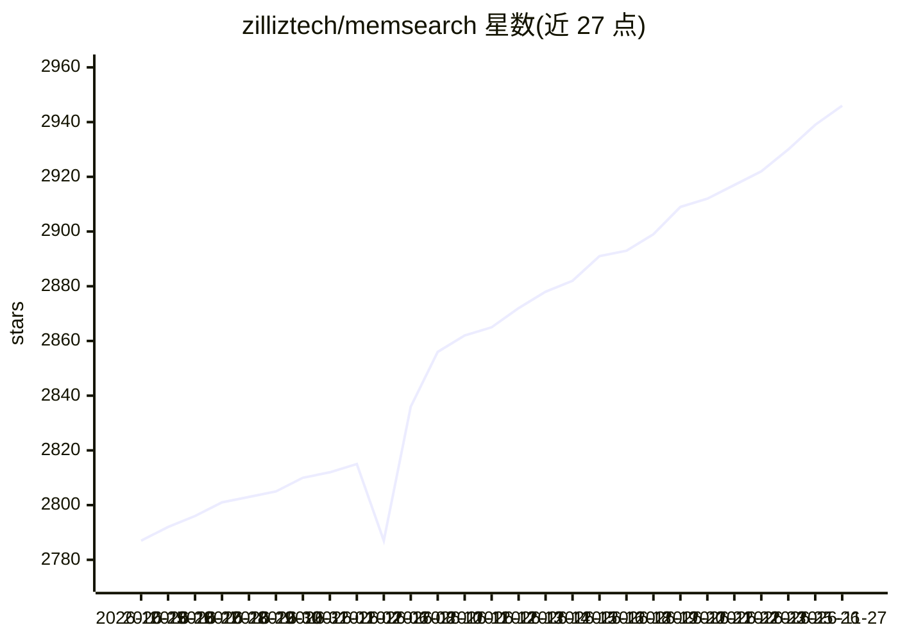

# zilliztech/memsearch

⭐ 2,946 · Python · MIT · 推送 2026-11-25 · [GitHub](https://github.com/zilliztech/memsearch) · [官网](https://zilliztech.github.io/memsearch/) · 组织维护

**为 AI 编码 agent 提供跨平台持久化语义记忆层**

MemSearch 以 Markdown 文件为记忆的源数据，用 Milvus（默认 Lite，可选 Zilliz Cloud 或 Docker 自托管）作可重建的影子索引，为 Claude Code、Codex、DeepSeek Harness、OpenClaw、OpenCode、WorkBuddy 六个编码 agent 提供跨平台共享记忆：自动捕获会话摘要、三层渐进检索、稠密+BM25 混合搜索与去重。嵌入默认用本地 ONNX bge-m3，也可选 OpenAI/Ollama。终端用户装插件即用，开发者可用 CLI 与 Python API 构建自有 agent 的记忆功能。

## 筛选速览

| 维度 | 判定 | 备注 |
|---|---|---|
| AI 角色 | `ai-ecosystem` | LLM/agent 周边工具 |
| 许可风险 | `permissive` | MIT |
| 部署形态 | `library` | 以包/库形式分发 |
| 模型依赖 | local-ok | 支持本地模型 |
| 硬件要求 | — | 无带数字的原话,不猜 |
| 安装摩擦 | `low` | 无编译、无系统依赖或容器化 |
| 成熟度 | — | 结构信号不足 |

## 能力要点

- 六个编码 agent 插件共享同一记忆层，一次配置全平台可用
- Markdown 为源、Milvus 为影子索引，SHA-256 去重与文件监听实时同步
- 三层检索（search→expand→transcript）与稠密+BM25+RRF 混合搜索
- 从重复工作流蒸馏出可安装的 agent skills（程序性记忆层，默认关闭）

## 适用场景

- 在新会话中恢复上次的调试过程与上下文
- 检索项目过往的架构与技术选型决策理由
- 把重复出现的工作流程固化为可复用的 agent skill

## 场景标签

`Agent 记忆` · 领域:Agent 开发

## 证据(README 行号)

> L33: - 🌐 **All Platforms, One Memory** — memories flow across Claude Code, Codex, DeepSeek Harness, OpenClaw, OpenCode, 
> L34: - 👥 **For Agent Users**, install a plugin and get persistent memory with zero effort; **for Agent Developers**, use
> L35: - 📄 **Markdown is the source of truth** — inspired by OpenClaw. Your memories are just `.md` files — human-readable

## 星数曲线

2026-10-25 2,787 → 2026-11-27 2,946（+159）

---
*卡片 v1 · prompt 1.4 · 生成 2026-11-26 · 置信度 high · 依据 README sha `bc3e1ec6b4f9` · [字段定义](../../DATASET.md)*
