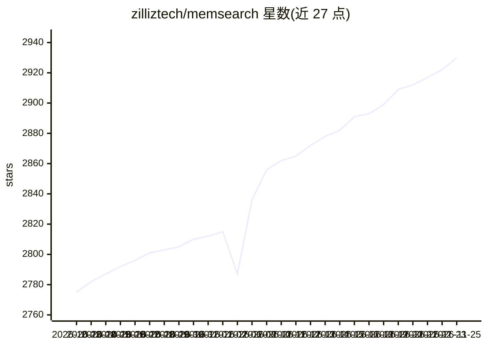

# zilliztech/memsearch

⭐ 2,930 · Python · MIT · 推送 2026-11-19 · [GitHub](https://github.com/zilliztech/memsearch) · [官网](https://zilliztech.github.io/memsearch/) · 组织维护

**为 AI 编码 agent 提供跨平台持久化记忆层**

MemSearch 为 Claude Code、Codex、DeepSeek Harness、OpenClaw、OpenCode、WorkBuddy 等 agent 提供统一的持久记忆：每次对话回合被自动摘要为 Markdown 日志，经嵌入索引后可在任一 agent 中召回。记忆以 .md 文件为源，Milvus 仅作可重建的影子索引；检索采用三层渐进式召回与 dense+BM25+RRF 混合搜索，SHA-256 哈希去重，文件监视器实时同步。另含 PROJECT.md/USER.md 后台维护与从重复工作流蒸馏 agent skill 的程序性记忆层，均默认关闭。普通用户装插件即用，开发者可用 CLI 与 Python API。

## 筛选速览

| 维度 | 判定 | 备注 |
|---|---|---|
| AI 角色 | `ai-ecosystem` | LLM/agent 周边工具 |
| 许可风险 | `permissive` | MIT |
| 部署形态 | `library` | 以包/库形式分发 |
| 模型依赖 | local-ok | 支持本地模型 |
| 硬件要求 | — | 无带数字的原话,不猜 |
| 安装摩擦 | `low` | 无编译、无系统依赖或容器化 |
| 成熟度 | — | 结构信号不足 |

## 能力要点

- 记忆跨 6 个 agent 平台共享，Markdown 为源、Milvus 作影子索引
- 3 层渐进式召回与 dense+BM25+RRF 混合搜索，SHA-256 去重与实时同步
- 可选 ONNX bge-m3 本地 CPU 嵌入，无需 API key
- 从重复工作流蒸馏可安装的 agent skills（程序性记忆层）

## 适用场景

- 在新的 agent 会话中恢复上次的调试过程与上下文
- 查询项目先前为何选择某个架构或库的决策理由
- 让 Claude Code 与 Codex 共享同一份项目记忆
- 把重复执行的工作流固化成可复用的 agent skill

## 场景标签

`Agent 记忆` · 领域:Agent 开发

## 证据(README 行号)

> L4:  Cross-platform semantic memory for AI coding agents.
> L32: - 🌐 **All Platforms, One Memory** — memories flow across Claude Code, Codex, DeepSeek Harness, OpenClaw, OpenCode, 
> L33: - 👥 **For Agent Users**, install a plugin and get persistent memory with zero effort; **for Agent Developers**, use

## 星数曲线

2026-10-23 2,775 → 2026-11-25 2,930（+155）

---
*卡片 v1 · prompt 1.4 · 生成 2026-11-23 · 置信度 high · 依据 README sha `4919dad0d797` · [字段定义](../../DATASET.md)*
