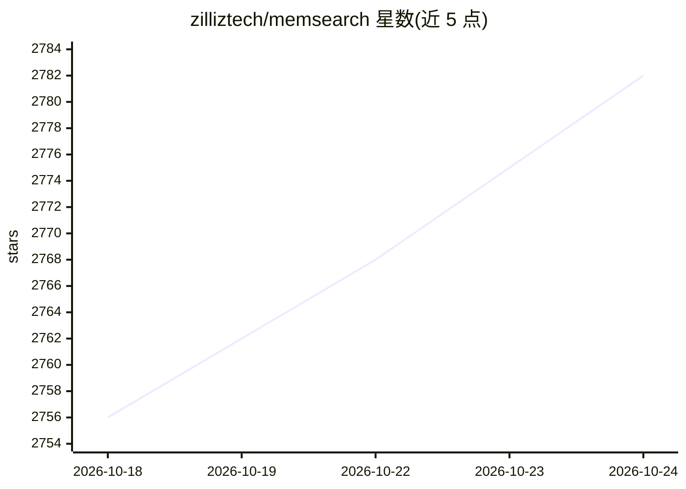

# zilliztech/memsearch

⭐ 2,787 · Python · MIT · 推送 2026-10-23 · [GitHub](https://github.com/zilliztech/memsearch) · [官网](https://zilliztech.github.io/memsearch/) · 组织维护 · 中文 README

**跨 AI 编程 agent 的持久统一记忆层（Markdown+Milvus）**

为 Claude Code、Codex、DeepSeek Harness、OpenClaw、OpenCode 等 AI 编程 agent 提供统一持久记忆：以插件形式自动捕获对话，写入人类可读的 .md 文件作为唯一事实源，Milvus 作为可重建的影子索引；检索采用稠密向量+BM25+RRF 混合三层召回。默认 ONNX bge-m3 本地 CPU 嵌入（约 558MB），支持 OpenAI/Ollama 嵌入提供方与 Milvus Lite/Zilliz Cloud/自托管 Milvus 后端。另有 PROJECT.md/USER.md 背景维护与从记忆蒸馏可安装技能（默认关闭）。面向 agent 用户（装插件即用）与开发者（CLI/Python API）。

## 筛选速览

| 维度 | 判定 | 备注 |
|---|---|---|
| AI 角色 | `ai-ecosystem` | LLM/agent 周边工具 |
| 许可风险 | `permissive` | MIT |
| 部署形态 | `library` | 以包/库形式分发 |
| 模型依赖 | local-ok | 支持本地模型 |
| 硬件要求 | — | 无带数字的原话,不猜 |
| 安装摩擦 | `low` | 无编译、无系统依赖或容器化 |
| 成熟度 | — | 结构信号不足 |

## 能力要点

- Markdown 为事实源、Milvus 为可重建影子索引
- 稠密向量+BM25+RRF 的三层混合检索
- 覆盖 Claude Code/Codex/DSH/OpenClaw/OpenCode 五平台插件
- 从重复工作流蒸馏可安装 agent 技能（Agent Skills 开放标准）

## 适用场景

- 在一个 agent 里的对话成为其他 agent 可检索的上下文
- 恢复历史调试线索与架构决策理由
- 让多平台 agent 共享同一项目记忆

## 场景标签

`Agent 记忆` `语义搜索` · 领域:Agent 开发

## 证据(README 行号)

> L4:  Cross-platform semantic memory for AI coding agents.
> L32: - 🌐 **All Platforms, One Memory** — memories flow across Claude Code, Codex, DeepSeek Harness, OpenClaw, and OpenCo
> L33: - 👥 **For Agent Users**, install a plugin and get persistent memory with zero effort; **for Agent Developers**, use

## 星数曲线

2026-10-18 2,756 → 2026-10-24 2,782（+26）

---
*卡片 v1 · prompt 1.4 · 生成 2026-10-21 · 置信度 high · 依据 README sha `d5ca8f1f33e2` · [字段定义](../../DATASET.md)*
