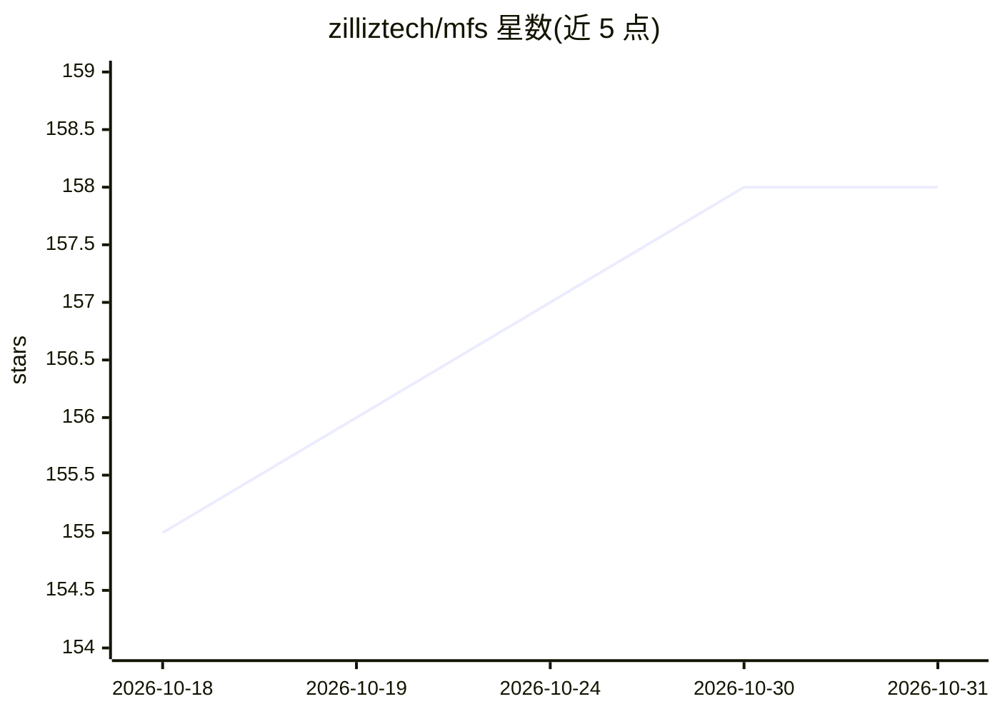

# zilliztech/mfs

⭐ 158 · Python · Apache-2.0 · 推送 2026-07-31 · [GitHub](https://github.com/zilliztech/mfs) · [官网](https://zilliztech.github.io/mfs/) · 组织维护

**面向 AI agent 的多源上下文统一索引与检索工作台**

由 Zilliz 团队开发的上下文聚合服务：将代码仓库、会话记忆、技能文件、文档、Slack/Jira/HubSpot 等云端数据源注册到统一命名空间，形成稳定 URI 下的类文件树。客户端（Rust CLI、SDK、agent 技能）连接 mfs-server，通过 mfs-ingest/mfs-find 两个技能供 agent 调用，提供 search/grep 语义检索与 ls/cat/tree 渐进浏览。本地运行下载约 600 MB 嵌入模型，无需 API key 与 GPU；也支持改用 OpenAI 等嵌入服务。

## 筛选速览

| 维度 | 判定 | 备注 |
|---|---|---|
| AI 角色 | `ai-ecosystem` | LLM/agent 周边工具 |
| 许可风险 | `permissive` | Apache-2.0 |
| 部署形态 | `self-host` | docker 或自建部署 |
| 模型依赖 | — | README 未给出锁定关系 |
| 硬件要求 | — | 无带数字的原话,不猜 |
| 安装摩擦 | `low` | 无编译、无系统依赖或容器化 |
| 成熟度 | — | 结构信号不足 |

## 能力要点

- 代码、记忆、文档、SaaS、数据库等多源统一为类文件树命名空间
- mfs-ingest / mfs-find 两个技能供 70+ 种 agent 加载调用
- 本地嵌入模型离线运行，无 API key、无 GPU、无云账号要求
- PDF/docx 本地转 Markdown，图像可配视觉模型描述

## 适用场景

- 让编程 agent 跨仓库、记忆和技能文件按语义检索上下文
- 把 Slack/Jira/HubSpot 等团队数据纳入 agent 可查询范围
- 为 agent 构建者提供统一的上下文供给层

## 场景标签

`Agent 记忆` `语义搜索` · 领域:Agent 开发

## 证据(README 行号)

> L3:  A context harness for AI agents — and for building them: one unified workspace over your code, memory, skills, docs
> L29: MFS gathers it under one shell: every source becomes a **file-like tree under a
> L41:  MFS architecture: clients (CLI, SDKs, agent skills) talk to mfs-server, which unifies many context sources into on

## 星数曲线

2026-10-18 155 → 2026-10-31 158（+3）

---
*卡片 v1 · prompt 1.4 · 生成 2026-10-22 · 置信度 high · 依据 README sha `6e21f9da4451` · [字段定义](../../DATASET.md)*
