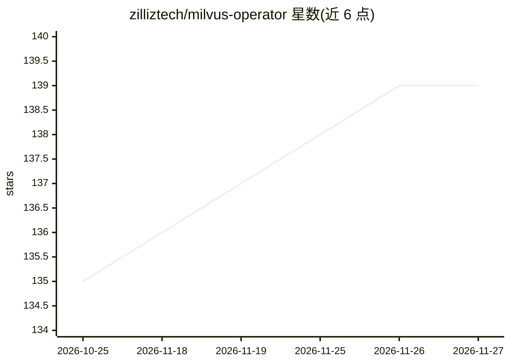

# zilliztech/milvus-operator

⭐ 139 · Go · Apache-2.0 · 推送 2026-11-25 · [GitHub](https://github.com/zilliztech/milvus-operator) · [官网](https://milvus.io) · 组织维护

**在 Kubernetes 上声明式部署和管理 Milvus 向量数据库的 Operator**

该项目是 Milvus 向量数据库的 Kubernetes Operator，通过定义 Milvus 自定义资源（CRD），以声明式方式管理 Milvus 全套服务栈，包括 etcd、pulsar/minio 等依赖组件的部署、滚动升级、动态配置重载、健康检查、HPA 自动扩缩容与资源清理。README 将其定位为面向生产的部署方式，与面向初学者的 Helm 安装形成两条路径；支持 helm 和 kubectl raw manifests 两种安装方式，默认管理 Milvus v2.6.27。

## 筛选速览

| 维度 | 判定 | 备注 |
|---|---|---|
| AI 角色 | `ai-ecosystem` | LLM/agent 周边工具 |
| 许可风险 | `permissive` | Apache-2.0 |
| 部署形态 | `library` | 以包/库形式分发 |
| 模型依赖 | — | README 未给出锁定关系 |
| 硬件要求 | — | 无带数字的原话,不猜 |
| 安装摩擦 | `low` | 无编译、无系统依赖或容器化 |
| 成熟度 | — | 结构信号不足 |

## 能力要点

- 基于 Kubernetes CRD 的声明式 Milvus 部署管理
- 一键部署 Milvus 及 etcd/pulsar/minio 依赖栈
- 支持滚动升级、动态配置重载、HPA 自动扩缩容、健康检查与诊断
- 提供 helm 与 kubectl raw manifests 两种安装方式

## 适用场景

- 在生产 Kubernetes 集群中高可用部署 Milvus 向量数据库
- 对 Milvus 集群做滚动升级与动态配置调整
- 按需扩缩 Milvus 集群规模并监控健康状态

## 场景标签

 · 领域:数据库/云原生基础设施

## 证据(README 行号)

> L11: Milvus is a cloud-native, open-source vector database built to manage embedding vectors generated by machine learni
> L13: The Milvus Operator provides an easy and solid solution to deploy and manage a full Milvus service stack including 

## 星数曲线

2026-10-25 135 → 2026-11-27 139（+4）

---
*卡片 v1 · prompt 1.4 · 生成 2026-11-27 · 置信度 high · 依据 README sha `1b017696bf9c` · [字段定义](../../DATASET.md)*
