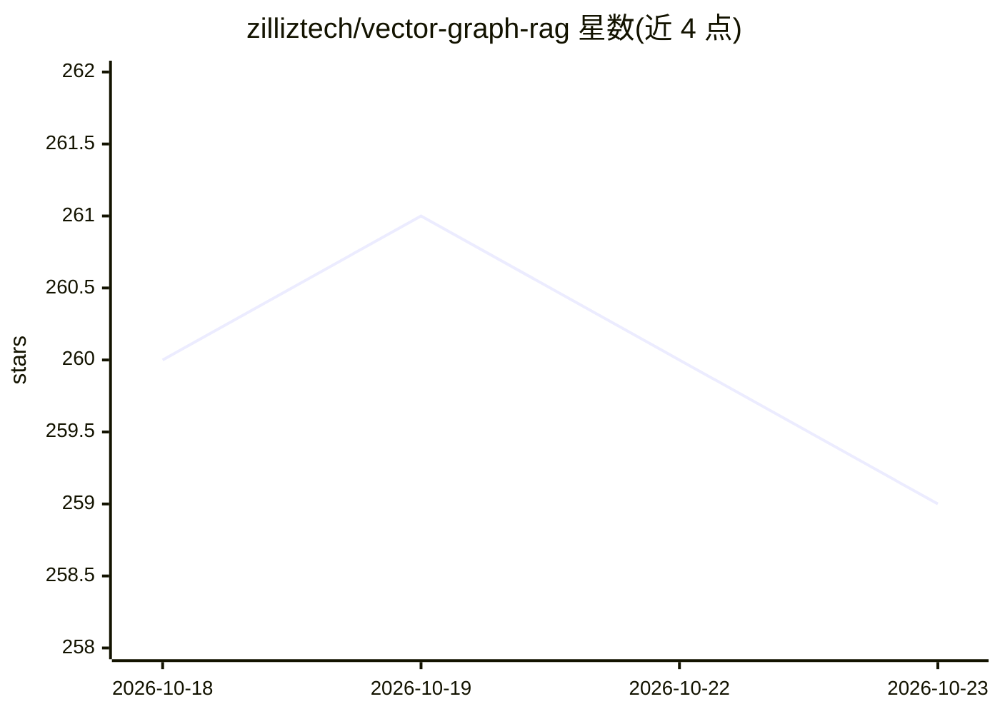

# zilliztech/vector-graph-rag

⭐ 259 · Python · MIT · 推送 2026-10-16 · [GitHub](https://github.com/zilliztech/vector-graph-rag) · [官网](https://zilliztech.github.io/vector-graph-rag/) · 组织维护

**纯向量检索实现 Graph RAG 的多跳问答库**

以 Python 库形式提供的 Graph RAG 框架，将实体与关系编码为向量存入 Milvus，通过向量检索、子图扩展与 LLM 重排（单遍生成式或两阶段 Jev 打分）完成多跳问答，无需图数据库。默认使用 Milvus Lite 单文件零配置运行，可切换到远程 Milvus 或 Zilliz Cloud。面向知识密集领域（法律、金融、医疗、文献），支持 OpenAI/HuggingFace/Ollama/Jina 等嵌入提供方，附 React 可视化前端与 FastAPI REST API。注意：源级增量写入非事务原子，可重试收敛。

## 筛选速览

| 维度 | 判定 | 备注 |
|---|---|---|
| AI 角色 | `ai-ecosystem` | LLM/agent 周边工具 |
| 许可风险 | `permissive` | MIT |
| 部署形态 | `self-host` | docker 或自建部署 |
| 模型依赖 | local-ok | 支持本地模型 |
| 硬件要求 | — | 无带数字的原话,不猜 |
| 安装摩擦 | `low` | 无编译、无系统依赖或容器化 |
| 成熟度 | — | 结构信号不足 |

## 能力要点

- 实体/关系向量化入 Milvus，无需图数据库
- 单遍生成式重排或两阶段 Jev 关系与段落打分
- 默认 Milvus Lite 单文件零配置，可切远程 Milvus/Zilliz Cloud
- 附带 React 图可视化前端与 FastAPI REST API

## 适用场景

- 在法律、金融、医疗等知识密集语料上做多跳问答
- 不想部署图数据库的团队搭建 Graph RAG 检索
- 增量更新文档并交互式可视化知识图谱

## 场景标签

 · 领域:LLM 基础设施/RAG

## 证据(README 行号)

> L12: > 💡 Encode entities and relations as vectors in Milvus, retrieve multi-hop evidence with single-pass generative rer
> L22: - **No Graph Database Required** — Pure vector search with Milvus, no Neo4j or other graph databases needed
> L166: Documents → Triplet Extraction (LLM) → Entities + Relations → Embedding → Milvus

## 星数曲线

2026-10-18 260 → 2026-10-23 259（-1）

---
*卡片 v1 · prompt 1.4 · 生成 2026-10-22 · 置信度 mid · 依据 README sha `bd113ebbd8de` · [字段定义](../../DATASET.md)*
