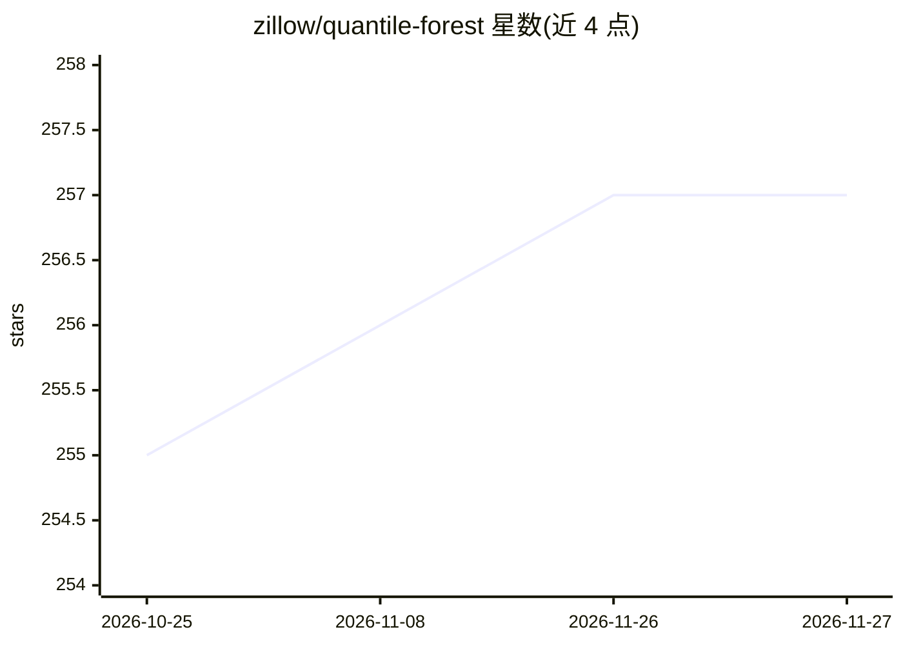

# zillow/quantile-forest

⭐ 257 · Python · Apache-2.0 · 推送 2026-11-19 · [GitHub](https://github.com/zillow/quantile-forest) · [官网](https://zillow.github.io/quantile-forest/) · 组织维护

**给数据科学家的分位数回归森林库：预测区间与不确定性估计**

提供与 scikit-learn 兼容的分位数回归森林 Python 实现，基于 Cython 优化并扩展 scikit-learn 森林估计器。支持预测时估计任意分位数而无需重新训练，提供袋外估计、分位数秩计算与邻近计数方法，支持样本权重、多目标、单调约束与缺失值，可作为 scikit-learn 森林回归器的直接替换。通过 pip 或 conda-forge 安装，附带文档与示例。

## 筛选速览

| 维度 | 判定 | 备注 |
|---|---|---|
| AI 角色 | `ai-native` | 本体是模型或模型工具 |
| 许可风险 | `permissive` | Apache-2.0 |
| 部署形态 | `library` | 以包/库形式分发 |
| 模型依赖 | — | README 未给出锁定关系 |
| 硬件要求 | — | 无带数字的原话,不猜 |
| 安装摩擦 | `low` | 无编译、无系统依赖或容器化 |
| 成熟度 | — | 结构信号不足 |

## 能力要点

- 预测时估计任意条件分位数，无需重新训练
- Cython 优化的实现，兼容并可替换 scikit-learn 森林回归器
- 支持袋外估计、分位数秩、邻近计数
- 支持样本权重、多目标、单调约束与缺失值

## 适用场景

- 对房价等数据拟合模型并输出预测区间
- 在高维数据上做条件分位数估计
- 为回归任务提供不确定性量化

## 场景标签

 · 领域:机器学习/统计回归

## 证据(README 行号)

> L11: **quantile-forest** offers a Python implementation of quantile regression forests compatible with scikit-learn.
> L13: Quantile regression forests (QRF) are a non-parametric, tree-based ensemble method for estimating conditional quant

## 星数曲线

2026-10-25 255 → 2026-11-27 257（+2）

---
*卡片 v1 · prompt 1.4 · 生成 2026-11-25 · 置信度 high · 依据 README sha `7b854d46762d` · [字段定义](../../DATASET.md)*
