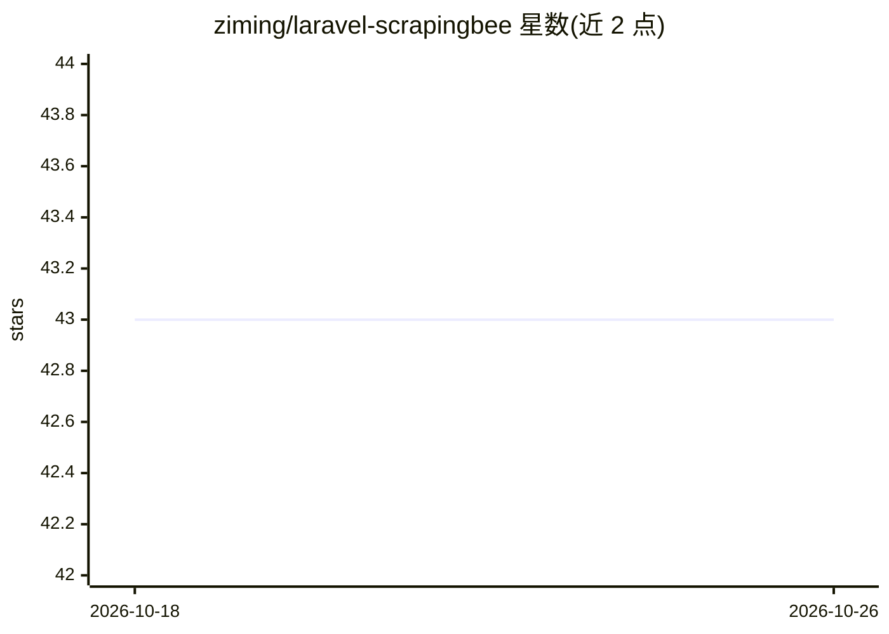

# ziming/laravel-scrapingbee

⭐ 43 · PHP · MIT · 推送 2026-09-17 · [GitHub](https://github.com/ziming/laravel-scrapingbee) · [官网](https://www.scrapingbee.com/?fpr=php-laravel) · 个人维护

**Laravel 的 ScrapingBee 网页抓取 API 封装库**

面向 PHP Laravel 开发者的 Composer 包，将 ScrapingBee 网页抓取 API 封装为链式调用的客户端类：提供通用抓取客户端（支持 GET/POST、广告屏蔽、用量统计等）以及针对 Google 搜索、Fast Search、Walmart 搜索与商品、Amazon 搜索与商品、YouTube 搜索/元数据/字幕/可训练性、ChatGPT 与 Gemini 查询的专用客户端。通过发布配置文件设置 API key，测试套件使用 Laravel HTTP fake，不消耗 ScrapingBee 额度。使用需持有 ScrapingBee 账号。

## 筛选速览

| 维度 | 判定 | 备注 |
|---|---|---|
| AI 角色 | `ai-ecosystem` | LLM/agent 周边工具 |
| 许可风险 | `permissive` | MIT |
| 部署形态 | `None` |  |
| 模型依赖 | — | README 未给出锁定关系 |
| 硬件要求 | — | 无带数字的原话,不猜 |
| 安装摩擦 | `low` | 无编译、无系统依赖或容器化 |
| 成熟度 | — | 结构信号不足 |

## 能力要点

- 通用抓取客户端支持链式调用与 setParams/addParams 批量设参
- 覆盖 Google/Walmart/Amazon/YouTube 专用抓取客户端
- 提供 ChatGPT 与 Gemini 查询客户端
- 测试套件使用 Laravel HTTP fake，不消耗 API 额度

## 适用场景

- 在 Laravel 应用中集成 ScrapingBee 网页抓取
- 抓取 Google/Amazon/Walmart 搜索与商品数据
- 获取 YouTube 视频元数据与字幕，或调用 ChatGPT/Gemini 查询端点

## 场景标签

`网页抓取` · 领域:效率与自动化

## 证据(README 行号)

> L1: # A PHP Laravel Library for ScrapingBee
> L6: A PHP Laravel Package for ScrapingBee

## 星数曲线

2026-10-18 43 → 2026-10-26 43（+0）

---
*卡片 v1 · prompt 1.4 · 生成 2026-10-25 · 置信度 high · 依据 README sha `b1833c605b38` · [字段定义](../../DATASET.md)*
