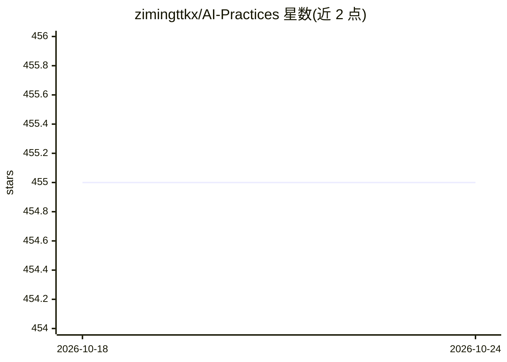

# zimingttkx/AI-Practices

⭐ 455 · Jupyter Notebook · MIT · 推送 2026-10-23 · [GitHub](https://github.com/zimingttkx/AI-Practices) · [官网](https://zimingttkx.github.io/AI-Practices/) · 个人维护 · 中文 README

**机器学习与深度学习系统化实战教程库（14 模块）**

以 500+ Python 文件与 280+ Jupyter Notebooks 组成的 AI 学习与实践仓库，按 14 个模块组织：从数学基础、经典机器学习（线性回归、SVM、集成学习）到神经网络、CV、序列模型、生成模型（VAE/GAN/DDPM）、强化学习（DQN 到 SAC/PPO）、大语言模型（LoRA 微调、RAG、RLHF/DPO）、多模态、部署优化、分布式训练与智能体推理；含 4 个 Kaggle 竞赛方案与 100+ 单元测试。技术栈覆盖 PyTorch 2.x、TensorFlow 2.13+、Keras 3.x，以 git clone 方式使用，README 列出最低/推荐硬件配置。

## 筛选速览

| 维度 | 判定 | 备注 |
|---|---|---|
| AI 角色 | `ai-knowledge` | 知识聚合/清单类 |
| 许可风险 | `permissive` | MIT |
| 部署形态 | `None` |  |
| 模型依赖 | — | README 未给出锁定关系 |
| 硬件要求 | — | 无带数字的原话,不猜 |
| 安装摩擦 | `low` | 无编译、无系统依赖或容器化 |
| 成熟度 | — | 结构信号不足 |

## 能力要点

- 500+ Python 文件、280+ Notebooks、14 大模块的学习路径
- 覆盖 ML/DL/CV/NLP/RL/LLM/多模态/部署/分布式训练
- 含 4 个 Kaggle 竞赛方案（2 金牌）与 100+ 单元测试
- PyTorch 2.x、TensorFlow 2.13+、Keras 3.x 双框架技术栈

## 适用场景

- 系统学习从数学基础到大模型与智能体的 AI 技术栈
- 查看 Kaggle 金牌竞赛方案与可运行代码实现
- 参考量化、剪枝、TensorRT/vLLM 等部署优化实现

## 场景标签

 · 领域:机器学习/深度学习教育

## 证据(README 行号)

> L25: - **系统化学习路径** — 从基础数学到前沿技术，14个模块循序渐进
> L128: |05-kaggle-competitions|**4个Kaggle竞赛方案**（含2个金牌）|

## 星数曲线

2026-10-18 455 → 2026-10-24 455（+0）

---
*卡片 v1 · prompt 1.4 · 生成 2026-10-21 · 置信度 high · 依据 README sha `b8a93fdcad62` · [字段定义](../../DATASET.md)*
