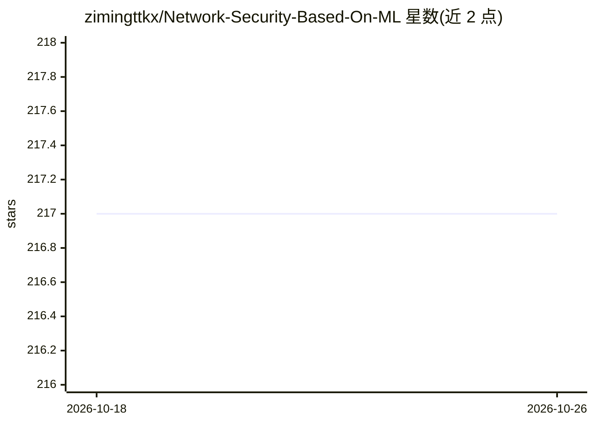

# zimingttkx/Network-Security-Based-On-ML

⭐ 217 · Python · MIT · 推送 2026-10-02 · [GitHub](https://github.com/zimingttkx/Network-Security-Based-On-ML) · 个人维护 · 中文 README

**Linux 服务器入侵防御系统：规则引擎+可选 ML 异常检测丢包**

NIPS 是服务端 IPS：在 Linux 上经 NFQUEUE/iptables 拦截流量，由确定性规则引擎（黑名单、限速、签名规则）加可插拔异常检测器对数据包打分并丢弃恶意包。ML 检测（Kitsune 在线无监督自编码器集成、LUCID 1D CNN）默认关闭，删除检测器目录仍可纯规则运行。提供 FastAPI 管理接口、CLI、SQLite 告警/审计存储与 Prometheus 指标。实时拦截需 Linux root，macOS 仅支持开发与离线 pcap 测试。

## 筛选速览

| 维度 | 判定 | 备注 |
|---|---|---|
| AI 角色 | `ai-enhanced` | 去掉 AI 部分产品仍成立 |
| 许可风险 | `permissive` | MIT |
| 部署形态 | `self-host` | docker 或自建部署 |
| 模型依赖 | — | README 未给出锁定关系 |
| 硬件要求 | — | 无带数字的原话,不猜 |
| 安装摩擦 | `low` | 无编译、无系统依赖或容器化 |
| 成熟度 | — | 结构信号不足 |

## 能力要点

- 规则引擎常驻 + 检测器插件化（默认关闭，支持第三方检测器契约）
- Kitsune（NDSS'18）在线无监督异常检测，90 特征、无需标签
- 签名规则支持源/端口/TCP flags/速率条件的按包丢弃
- 告警与审计写入 SQLite(WAL)，支持 SIEM 导出（csv/jsonl）

## 适用场景

- 在 Linux 服务器上对 TCP/UDP 流量做实时入侵防御
- 运维人员通过 API/CLI 管理黑白名单、签名规则与拦截开关
- 离线 pcap 回放测试检测流水线，导出告警对接 SIEM

## 场景标签

`网络安全` · 领域:学习与行业

## 证据(README 行号)

> L26: The learning detectors are a **plug-in**, and they are **off by default**:
> L35: With `enabled: false`, no ML module is imported or constructed: deleting `networksecurity/engine/kitsune/` and `net
> L57: - Linux for live interception (nfqueue + iptables, root required)

## 星数曲线

2026-10-18 217 → 2026-10-26 217（+0）

---
*卡片 v1 · prompt 1.4 · 生成 2026-10-22 · 置信度 high · 依据 README sha `d9c3aa0925d7` · [字段定义](../../DATASET.md)*
