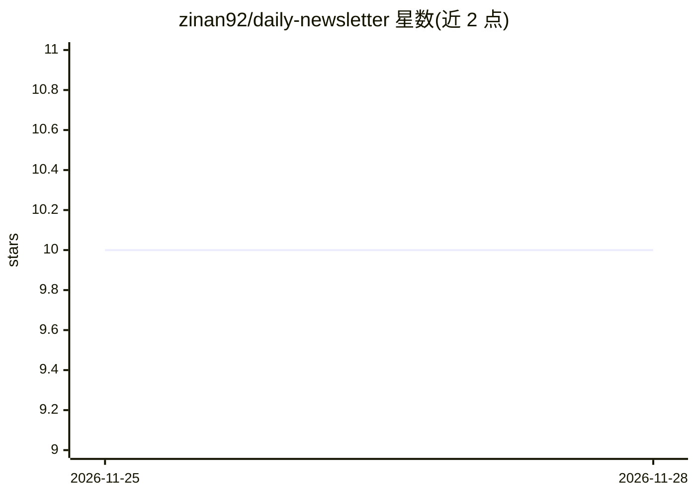

# zinan92/daily-newsletter

⭐ 10 · Python · MIT · 推送 2026-11-07 · [GitHub](https://github.com/zinan92/daily-newsletter) · [官网](https://park-ai-intel.com/daily/) · 个人维护 · 中文 README

**个人 AI 信息日报流水线：抓取多源内容生成中文日报**

local-first 的每日信息流水线，从官方博客、RSS、GitHub Trending、X 账号、播客/视频、公众号种子等来源抓取内容，经 5 个阶段（fetch→to_md→coarse_filter→ai_process→archive）处理，内容理解、合并、打分与写作由 LLM 完成，最终输出单一 Markdown 日报并通过飞书机器人推送。需要 Python 3.11+ 与一个 AI 接入（DeepSeek API key、OpenAI 兼容端点，或 Claude Code/Codex CLI 登录态）；X、抖音、视频转写等来源需额外登录态或依赖，缺失时对应来源被跳过。另提供 Agent Skill 封装（SKILL.md）供 agent 操作流水线。

## 筛选速览

| 维度 | 判定 | 备注 |
|---|---|---|
| AI 角色 | `ai-ecosystem` | LLM/agent 周边工具 |
| 许可风险 | `permissive` | MIT |
| 部署形态 | `library` | 以包/库形式分发 |
| 模型依赖 | locked-api |  |
| 硬件要求 | — | 无带数字的原话,不猜 |
| 安装摩擦 | `medium` | 含编译或系统依赖之一 |
| 成熟度 | — | 结构信号不足 |

## 能力要点

- 5-stage 流水线，AI system prompt 负责内容判断、合并、打分与写作
- 多种 LLM 接入：DeepSeek API、OpenAI 兼容端点、Claude Code / Codex CLI，支持备用 provider 自动切换
- doctor.py 逐项检查本机可用来源与 AI 配置，缺失来源自动跳过
- 提供 SKILL.md / AGENTS.md 的 Agent Skill 封装，支持 agent 排查与操作流水线

## 适用场景

- 每天自动把 AI 领域信息凝练成一份中文日报并推送到飞书
- 用自己的 X/播客登录态构建个性化的每日信息收集管线
- 把日报流水线交给 AI agent 维护与排查

## 场景标签

`工作流自动化` · 领域:效率与自动化

## 证据(README 行号)

> L21: 生产链路现在是 5-stage：`fetch -> to_md -> coarse_filter -> ai_process -> archive`。脚本只负责下载、转写、粗筛、保存和推送；内容判断、合并、打分、分类、快讯全集/深
> L56: |`deepseek`（默认）|API|DeepSeek API key|`PARKIO_DEEPSEEK_KEY`|

## 星数曲线

2026-11-25 10 → 2026-11-28 10（+0）

---
*卡片 v1 · prompt 1.4 · 生成 2026-11-25 · 置信度 mid · 依据 README sha `61f90c2188de` · [字段定义](../../DATASET.md)*
