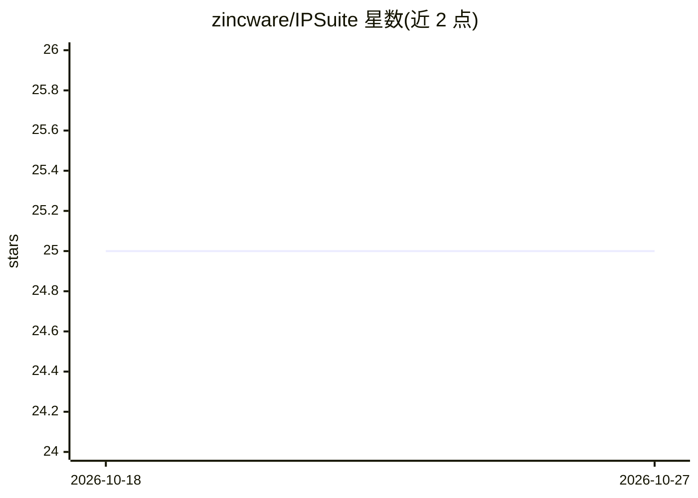

# zincware/IPSuite

⭐ 25 · Python · EPL-2.0 · 推送 2026-10-19 · [GitHub](https://github.com/zincware/IPSuite) · [官网](https://ipsuite.readthedocs.io) · 组织维护

**生成机器学习原子间势的工具套件，面向分子模拟**

IPSuite 提供生成 Machine Learned Interatomic Potentials（机器学习原子间势）的工具，基于 ZnTrack/DVC 的模块化工作流组织。pip 安装为最小化依赖，第三方 ML 包（如 apax、mace、gap）需按需手动安装；另提供内置 apax/mace/gap 的 Linux Docker 镜像，可用 dvc repro 或 Jupyter Lab 交互运行，并附多个示例 notebook。可用于科研场景的 learning-on-the-fly 势函数构建，附论文引用条目。

## 筛选速览

| 维度 | 判定 | 备注 |
|---|---|---|
| AI 角色 | `ai-native` | 本体是模型或模型工具 |
| 许可风险 | `viral` | EPL-2.0 |
| 部署形态 | `self-host` | docker 或自建部署 |
| 模型依赖 | — | README 未给出锁定关系 |
| 硬件要求 | — | 无带数字的原话,不猜 |
| 安装摩擦 | `low` | 无编译、无系统依赖或容器化 |
| 成熟度 | — | 结构信号不足 |

## 能力要点

- 基于 ZnTrack/DVC 的模块化工作流
- 提供内置 apax/mace/gap MLP 的 Docker 镜像
- pip 安装最小化，ML 依赖按需手动安装
- 示例 notebook 与论文引用

## 适用场景

- 构建机器学习原子间势做分子动力学模拟
- 用 learning-on-the-fly 方式协作开发势函数
- 在预置 Docker 环境中运行 DVC 工作流或 Jupyter

## 场景标签

`科研工具` · 领域:学习与行业

## 证据(README 行号)

> L13: IPS provides you with tools to generate Machine Learned Interatomic Potentials.
> L70: @article{zillsCollaborationMachineLearnedPotentials2024,

## 星数曲线

2026-10-18 25 → 2026-10-27 25（+0）

---
*卡片 v1 · prompt 1.4 · 生成 2026-10-26 · 置信度 high · 依据 README sha `47c811d02ad5` · [字段定义](../../DATASET.md)*
