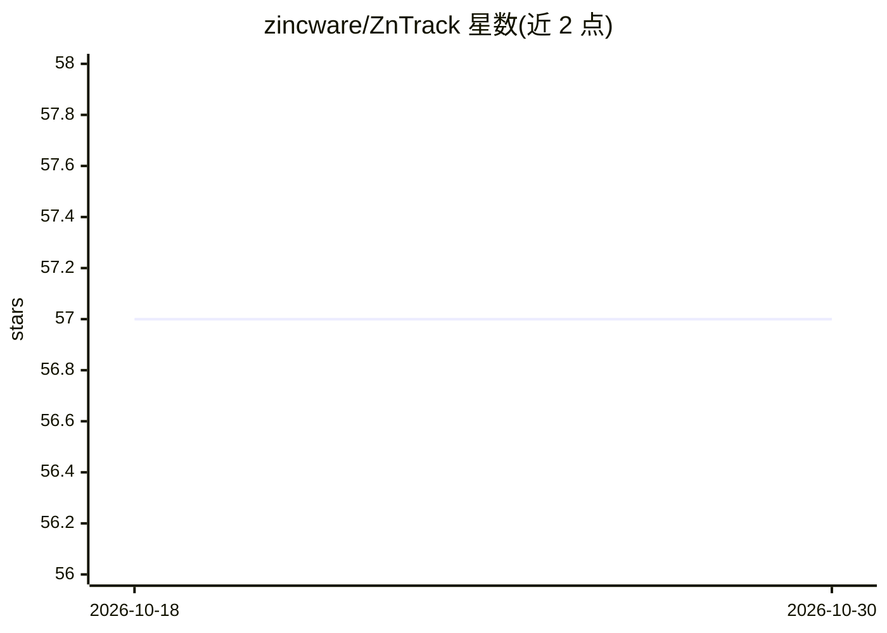

# zincware/ZnTrack

⭐ 57 · Python · Apache-2.0 · 推送 2026-10-26 · [GitHub](https://github.com/zincware/ZnTrack) · [官网](https://zntrack.readthedocs.io) · 组织维护

**把 Python 代码转为可复现 DVC 工作流的库**

ZnTrack 是构建在 DVC 之上的 Python 包，将现有 Python 代码结构化为有向图工作流：每个步骤为 Node 类，属性定义输入（参数与依赖）和输出，run 方法包含计算逻辑；基于 Python dataclasses 自动生成 __init__。提供参数、输出与指标跟踪，通过 Git 与团队协作共享工作流，可将工作流打包为 Python 包。结果以文件存储并可直接通过 ZnTrack 加载，无需关心路径与格式。以 PyPI 包分发，采用 Apache-2.0 许可。

## 筛选速览

| 维度 | 判定 | 备注 |
|---|---|---|
| AI 角色 | `ai-ecosystem` | LLM/agent 周边工具 |
| 许可风险 | `permissive` | Apache-2.0 |
| 部署形态 | `library` | 以包/库形式分发 |
| 模型依赖 | — | README 未给出锁定关系 |
| 硬件要求 | — | 无带数字的原话,不猜 |
| 安装摩擦 | `low` | 无编译、无系统依赖或容器化 |
| 成熟度 | — | 结构信号不足 |

## 能力要点

- 将 Python 脚本转换为有向图结构的可复现工作流
- 参数、输出与指标跟踪，通过 Git 协作共享
- 基于 DVC 构建，可用 dvc repro 或 paraffin 运行图
- 结果文件可通过 ZnTrack 直接加载，免手写路径与格式解析

## 适用场景

- 把机器学习或分子模拟脚本改造成可复现、可分享的工作流
- 团队通过 Git/DVC 协作管理实验参数与产物
- 将工作流节点打包为 Python 包供其他项目复用

## 场景标签

`工作流自动化` · 领域:效率与自动化

## 证据(README 行号)

> L16: ZnTrack (`zɪŋk træk`) is a lightweight and easy-to-use Python package for
> L26: - **DVC Integration**: ZnTrack is built on top of DVC for version control and experiment management and seamlessly 

## 星数曲线

2026-10-18 57 → 2026-10-30 57（+0）

---
*卡片 v1 · prompt 1.4 · 生成 2026-10-24 · 置信度 high · 依据 README sha `63a8aa725ae1` · [字段定义](../../DATASET.md)*
