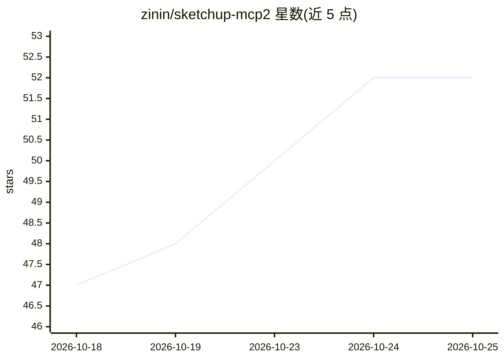

# zinin/sketchup-mcp2

⭐ 52 · Ruby · MIT · 推送 2026-10-20 · [GitHub](https://github.com/zinin/sketchup-mcp2) · 个人维护

**把 Claude 等 MCP 客户端接入 SketchUp 做自然语言 3D 建模的桥接服务**

双进程桥接架构：Python MCP 服务器（sketchup-mcp2，FastMCP）向 LLM 暴露类型化工具，Ruby SketchUp 扩展在 SketchUp 内运行 TCP 服务器（127.0.0.1:9876）对活动模型执行命令。工具覆盖几何创建/变换、材质、布尔运算、倒角/圆角、榫卯接合、导出 skp/obj/stl 等格式、模型内省、撤销及默认开启的 eval_ruby 任意 Ruby 执行逃生口。支持多客户端并发、版本握手、原子撤销。TCP 套接字无鉴权，README 用大篇幅说明安全模型与 SSH 隧道方案。面向使用 Claude Code/Desktop 等 MCP 客户端的 3D 建模用户与开发者。

## 筛选速览

| 维度 | 判定 | 备注 |
|---|---|---|
| AI 角色 | `ai-ecosystem` | LLM/agent 周边工具 |
| 许可风险 | `permissive` | MIT |
| 部署形态 | `desktop` | 安装包/桌面程序 |
| 模型依赖 | locked-api |  |
| 硬件要求 | — | 无带数字的原话,不猜 |
| 安装摩擦 | `low` | 无编译、无系统依赖或容器化 |
| 成熟度 | — | 结构信号不足 |

## 能力要点

- 类型化工具目录：几何/材质/布尔/倒角圆角/榫卯接合/多格式导出/模型内省/撤销
- 默认开启 eval_ruby 任意 Ruby 执行，可在设置中关闭；套接字无鉴权，附安全模型说明
- 多客户端并发（全局 FIFO 串行化）与一次性版本握手
- 每次变更包裹在 start_operation/commit_operation 中，单次撤销可整体回滚

## 适用场景

- 用自然语言让 Claude 在 SketchUp 中创建和修改家具、柜体等模型
- 导出 STL 供 3D 打印或其他流程使用
- 通过 eval_ruby 与 Ruby cookbook 驱动 SketchUp API 完成更复杂建模

## 场景标签

 · 领域:3D 建模/CAD 工具集成

## 证据(README 行号)

> L9: - **Python MCP server** (`sketchup-mcp2` on PyPI) — exposes typed tools to the LLM via the Model Context Protocol.
> L5: > Connect Claude (or any MCP-aware AI client) to SketchUp for prompt-driven 3D modeling.

## 星数曲线

2026-10-18 47 → 2026-10-25 52（+5）

---
*卡片 v1 · prompt 1.4 · 生成 2026-10-24 · 置信度 high · 依据 README sha `a55b1b9ccaa9` · [字段定义](../../DATASET.md)*
