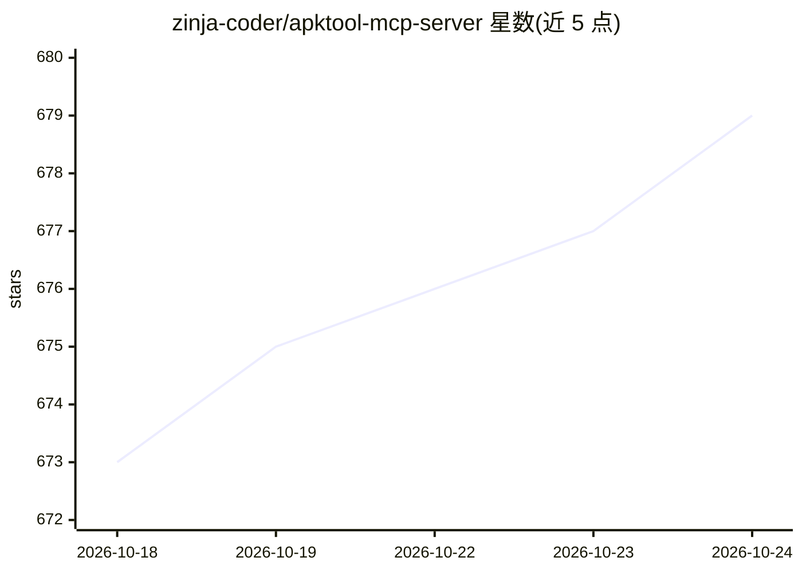

# zinja-coder/apktool-mcp-server

⭐ 679 · Python · Apache-2.0 · 推送 2026-07-02 · [GitHub](https://github.com/zinja-coder/apktool-mcp-server) · 个人维护

**把 apktool 接入 LLM 的 MCP 服务器：对话式逆向分析 Android APK**

基于 Model Context Protocol 的 MCP 服务器，封装 apktool 的解码、构建、smali 与资源读写等操作为 13 个 MCP 工具，供 Claude Desktop、Cherry Studio 等 LLM 客户端通过自然语言对 Android APK 做反编译浏览、静态分析、漏洞排查与 smali/资源修改。属于 Zin 逆向工程 MCP 套件之一，可经 zin-mcp-client 桥接 Ollama 本地模型。需先安装 apktool 与 uv，通过克隆仓库并以 uv 运行，或从 Releases 下载；README 声明仅限教育与授权安全测试用途。

## 筛选速览

| 维度 | 判定 | 备注 |
|---|---|---|
| AI 角色 | `ai-ecosystem` | LLM/agent 周边工具 |
| 许可风险 | `permissive` | Apache-2.0 |
| 部署形态 | `None` |  |
| 模型依赖 | local-ok | 支持本地模型 |
| 硬件要求 | — | 无带数字的原话,不猜 |
| 安装摩擦 | `low` | 无编译、无系统依赖或容器化 |
| 成熟度 | — | 结构信号不足 |

## 能力要点

- 13 个 MCP 工具：解码/构建 APK、读取与修改 smali、manifest 与资源文件、模式搜索
- 支持 Claude Desktop、Cherry Studio 配置，可经 zin-mcp-client 连接 Ollama 本地模型
- 提供漏洞检测、CTF、静态分析等示例提示词
- 在 Claude Desktop Client 上测试通过

## 适用场景

- 用对话让 LLM 反编译并审阅 APK 的 smali 代码与 manifest
- 排查 Android 应用的危险权限与暴露组件等安全问题
- 解 CTF 时让模型直接搜索与修改反编译代码

## 场景标签

 · 领域:安全/移动逆向工程

## 证据(README 行号)

> L18: **apktool-mcp-server** is a MCP server for the Apk Tool that integrates directly with Model Context Protocol (MCP) 
> L3: ⚡ Fully automated MCP server built on top of apktool to analyze Android APKs using LLMs like Claude — uncover vulner
> L37: The following MCP tools are available:

## 星数曲线

2026-10-18 673 → 2026-10-24 679（+6）

---
*卡片 v1 · prompt 1.4 · 生成 2026-10-21 · 置信度 high · 依据 README sha `4998428039a9` · [字段定义](../../DATASET.md)*
