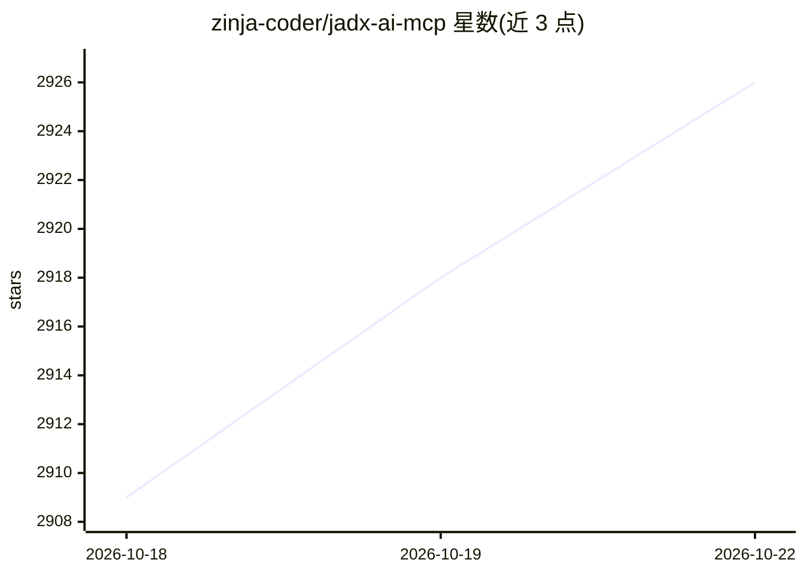

# zinja-coder/jadx-ai-mcp

⭐ 2,926 · Java · Apache-2.0 · 推送 2026-10-19 · [GitHub](https://github.com/zinja-coder/jadx-ai-mcp) · 个人维护

**让 LLM 通过 MCP 实时分析 JADX 反编译代码的插件+服务器**

由 JADX 插件（Java）与独立 Python MCP 服务器两部分组成：插件嵌入 JADX 反编译器，服务器通过 MCP 协议将反编译后的 Android 应用上下文暴露给 Claude Desktop、LM Studio、Cherry Studio 等 LLM 客户端。提供约 30 个 MCP 工具，覆盖获取类/方法源码、检索、交叉引用、重命名、加注释、读取 manifest 与资源文件、读取调试器栈帧等。面向做 Android 逆向、漏洞分析与静态分析的安全研究人员和开发者；要求 Java 11+ 与 Python 3.10+，通过 Releases 下载 jar 与服务器包安装。

## 筛选速览

| 维度 | 判定 | 备注 |
|---|---|---|
| AI 角色 | `ai-ecosystem` | LLM/agent 周边工具 |
| 许可风险 | `permissive` | Apache-2.0 |
| 部署形态 | `desktop` | 安装包/桌面程序 |
| 模型依赖 | locked-api |  |
| 硬件要求 | — | 无带数字的原话,不猜 |
| 安装摩擦 | `medium` | 含编译或系统依赖之一 |
| 成熟度 | — | 结构信号不足 |

## 能力要点

- 约 30 个 MCP 工具：类/方法源码读取、关键词检索、交叉引用、smali 获取
- 支持重命名类/方法/字段/包与在 JADX-GUI 中添加注释
- 读取 AndroidManifest、资源文件及调试器栈帧/线程/变量
- 支持 stdio 与 HTTP 流两种传输模式，可配置双端 host/port 跨机部署

## 适用场景

- 逆向 Android APK 时让 Claude 等 LLM 实时代码审查
- 通过对话检测硬编码密钥、不安全 API 等漏洞
- 让 AI 批量重命名混淆的类与方法并生成注释
- 调试 APK 时让 LLM 汇总栈帧与变量状态

## 场景标签

`网络安全` `代码审查` · 领域:编码与开发

## 证据(README 行号)

> L140: **JADX-AI-MCP** is a plugin for the JADX decompiler that integrates directly with Model Context Protocol (MCP) to 
> L185: **JADX MCP Server** is a standalone Python server that interacts with a `JADX-AI-MCP` plugin (see: jadx-ai-mcp) vi

## 星数曲线

2026-10-18 2,909 → 2026-10-22 2,926（+17）

---
*卡片 v1 · prompt 1.4 · 生成 2026-10-21 · 置信度 high · 依据 README sha `77526f365bac` · [字段定义](../../DATASET.md)*
