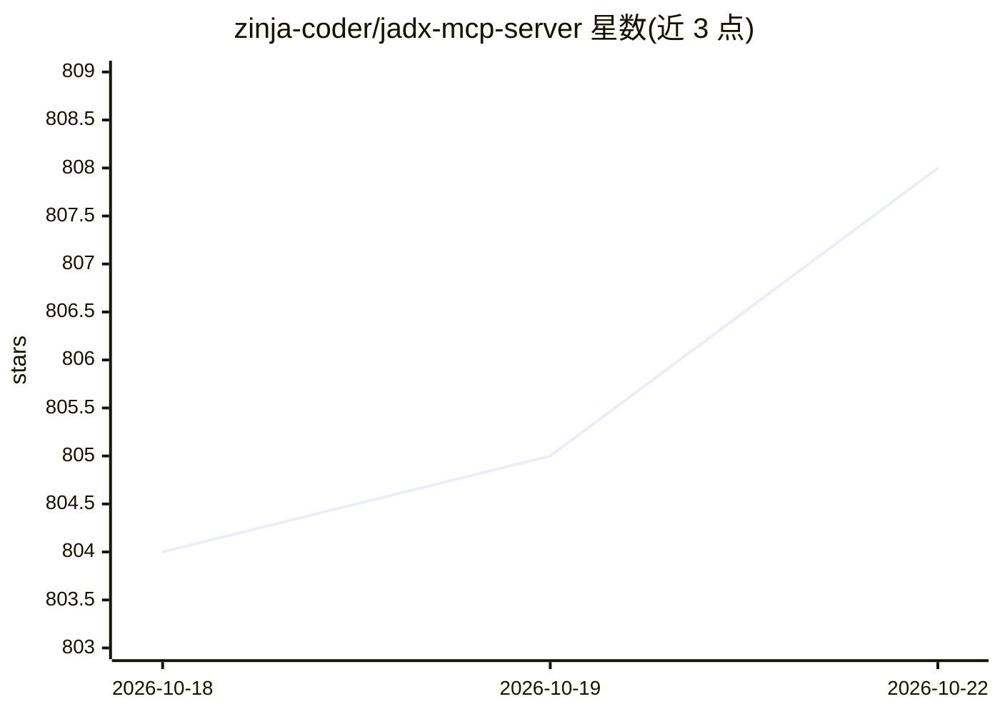

# zinja-coder/jadx-mcp-server

⭐ 808 · Python · Apache-2.0 · 推送 2026-10-19 · [GitHub](https://github.com/zinja-coder/jadx-mcp-server) · 个人维护

**连接 LLM 与 JADX 反编译插件的 MCP 服务器，用于 Android 逆向**

独立的 Python MCP 服务器，通过 HTTP 与修改版 jadx-gui（JADX-AI-MCP 插件）通信，让 Claude 等 LLM 实时读取反编译的 Android 应用上下文。提供 20 余个 MCP 工具：获取类源码、smali、AndroidManifest、资源文件、交叉引用、重命名变量、添加注释、读取调试器栈帧等；默认剥离 Kotlin 编译器元数据。支持 stdio 与 HTTP 传输，可配置双通道 host/port，附 OpenAI 兼容模型适配示例。限制：远程绑定为无认证明文 HTTP；仅在 Claude Desktop 上测试过。

## 筛选速览

| 维度 | 判定 | 备注 |
|---|---|---|
| AI 角色 | `ai-ecosystem` | LLM/agent 周边工具 |
| 许可风险 | `permissive` | Apache-2.0 |
| 部署形态 | `None` |  |
| 模型依赖 | local-ok | 支持本地模型 |
| 硬件要求 | — | 无带数字的原话,不猜 |
| 安装摩擦 | `medium` | 含编译或系统依赖之一 |
| 成熟度 | — | 结构信号不足 |

## 能力要点

- 20 余个 MCP 工具覆盖类源码、smali、manifest、资源、xrefs 与调试器信息读取
- 默认剥离 Kotlin @Metadata/@DebugMetadata（常见占 dump 的 25-50%），不改变行号
- LLM 客户端与 JADX 插件双通道连接，支持跨机远程部署
- 提供 OpenAI 兼容 API 的参考适配脚本（OpenRouter/LiteLLM/vLLM/Ollama 等）

## 适用场景

- 逆向分析 Android APK 时让 LLM 解释类与方法
- 用自然语言提示检测硬编码密钥等安全问题
- 调试 APK 时让 AI 汇总调试器栈帧、线程与变量
- 对反编译代码做重命名、注释等 AI 辅助修改

## 场景标签

 · 领域:安全/逆向工程

## 证据(README 行号)

> L142: **JADX MCP Server** is a standalone Python server that interacts with a modified version of `jadx-gui` (see: jadx-
> L146: **JADX-AI-MCP** is a plugin for the JADX decompiler that integrates directly with Model Context Protocol (MCP) to 
> L367: OpenRouter, LiteLLM, vLLM, Ollama's OpenAI layer, OmniRoute, … — `examples/openai_compatible_client.py`

## 星数曲线

2026-10-18 804 → 2026-10-22 808（+4）

---
*卡片 v1 · prompt 1.4 · 生成 2026-10-21 · 置信度 high · 依据 README sha `f1707a62e7cd` · [字段定义](../../DATASET.md)*
