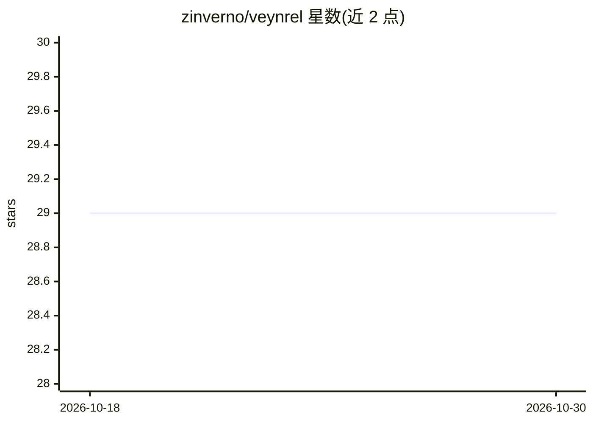

# zinverno/veynrel

⭐ 29 · TypeScript · MIT · 推送 2026-10-29 · [GitHub](https://github.com/zinverno/veynrel) · 个人维护

**Obsidian 笔记连接审阅、受控变更与间隔重复插件，AI 可选**

面向 Obsidian 用户的笔记审阅与整理插件：本地检查发现断链、结构问题与完全重复；基于嵌入索引的语义搜索与相似笔记；两两配对审阅由用户显式同意后可调用语言模型分析；Markdown 变更以预览+单独确认 Apply 的受控方式执行，多数操作带 Undo；内置 FSRS-6 间隔重复复习手写问答卡片。AI 提供方、首次索引构建均需显式配置，本地检查与复习无需 AI。语义总览上限 500 条笔记；生成式原子化、批量处理与 MOC 无通用回滚。

## 筛选速览

| 维度 | 判定 | 备注 |
|---|---|---|
| AI 角色 | `ai-enhanced` | 去掉 AI 部分产品仍成立 |
| 许可风险 | `permissive` | MIT |
| 部署形态 | `None` |  |
| 模型依赖 | local-ok | 支持本地模型 |
| 硬件要求 | — | 无带数字的原话,不猜 |
| 安装摩擦 | `low` | 无编译、无系统依赖或容器化 |
| 成熟度 | — | 结构信号不足 |

## 能力要点

- 本地健康检查（断链/结构问题/完全重复）无需 AI 提供方
- 配对分析需显式同意，变更经参数选择、before/after 预览与单独确认 Apply
- 本地 FSRS-6 间隔重复，`Question::Answer` 语法，计划跨重启保留
- 连接规则可在 top-K 之前按标签/文件夹抑制建议

## 适用场景

- 审阅笔记间的重复与潜在连接并决定保留或修改
- 在 Obsidian 内对手写问答卡做间隔重复复习
- 用语义搜索和嵌入索引找相关笔记，可选自托管 Ollama

## 场景标签

`知识库管理` `语义搜索` · 领域:知识与检索

## 证据(README 行号)

> L7: Veynrel brings a candidate list, evidence-led pair review, guarded Markdown changes and native spaced repetition int
> L83: |Local Health, topology, Recall and saved decisions|On your device; no AI provider needed.|
> L85: |Indexing and semantic text search|The configured embedding endpoint receives chunks or the query. Ollama can be lo

## 星数曲线

2026-10-18 29 → 2026-10-30 29（+0）

---
*卡片 v1 · prompt 1.4 · 生成 2026-10-26 · 置信度 high · 依据 README sha `680feee59582` · [字段定义](../../DATASET.md)*
