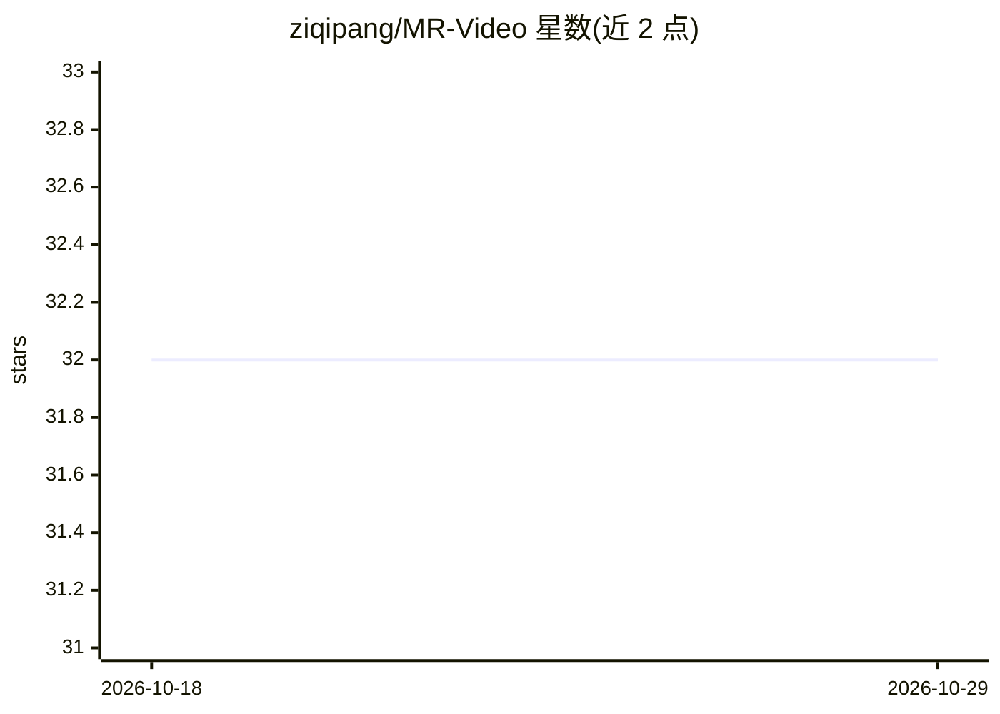

# ziqipang/MR-Video

⭐ 32 · Python · MIT · 推送 2026-06-18 · [GitHub](https://github.com/ziqipang/MR-Video) · 个人维护

**MapReduce 式长视频理解 agent 框架（NeurIPS 2025 论文代码）**

MR. Video 是围绕 MapReduce 模式构建的长视频理解 agent 框架：对短片段做密集感知（perception），再进行全局聚合与推理，输出视频问答结果。本仓库发布基于预生成 caption 运行问答 agent 流水线的代码，包含模型/provider 配置、LVBench/EgoSchema/VideoMME 三个基准的运行脚本与评测脚本。通过 API key（OpenAI/Gemini）或环境变量接入模型，中间结果以 JSON 落盘并可断点续跑。以 Python 源码形式安装运行。

## 筛选速览

| 维度 | 判定 | 备注 |
|---|---|---|
| AI 角色 | `ai-native` | 本体是模型或模型工具 |
| 许可风险 | `permissive` | MIT |
| 部署形态 | `library` | 以包/库形式分发 |
| 模型依赖 | — | README 未给出锁定关系 |
| 硬件要求 | — | 无带数字的原话,不猜 |
| 安装摩擦 | `low` | 无编译、无系统依赖或容器化 |
| 成熟度 | — | 结构信号不足 |

## 能力要点

- MapReduce 模式：短片段密集感知+全局聚合推理的长视频问答 agent 流水线
- 提供 LVBench、EgoSchema、VideoMME 三个基准的运行与评测脚本
- caption 文件托管于 HuggingFace，支持 CLI 参数与环境变量自定义路径
- 中间结果可复用，重跑同命令可从已有 JSON 续跑

## 适用场景

- 在长视频基准上复现论文的问答实验
- 基于预生成 caption 运行视频问答 agent 流水线
- 评测并对比长视频理解方法的预测结果

## 场景标签

`Agent 框架` `模型评测` · 领域:Agent 开发

## 证据(README 行号)

> L11: MR. Video is an agentic long-video understanding framework built around a MapReduce pattern: dense short-clip perce
> L17: scripts/                 Dataset runners for LVBench, EgoSchema, and VideoMME.

## 星数曲线

2026-10-18 32 → 2026-10-29 32（+0）

---
*卡片 v1 · prompt 1.4 · 生成 2026-10-25 · 置信度 high · 依据 README sha `04baf5e0b25d` · [字段定义](../../DATASET.md)*
