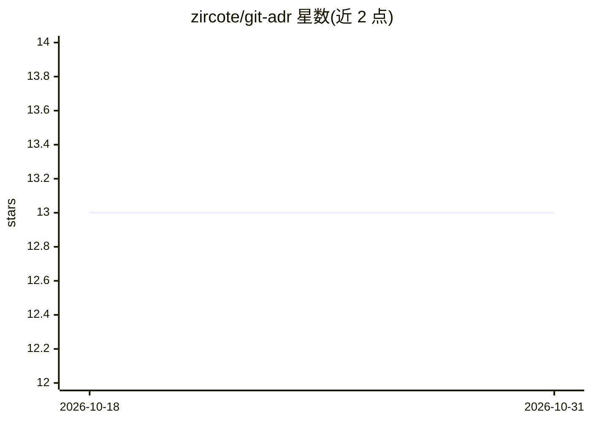

# zircote/git-adr

⭐ 13 · Rust · MIT · 推送 2026-09-14 · [GitHub](https://github.com/zircote/git-adr) · 个人维护

**基于 git notes 的架构决策记录(ADR)管理 CLI 工具**

Rust 编写的命令行工具，将架构决策记录存储在 git notes（refs/notes/adr 等）而非仓库文件中，支持创建、编辑、全文搜索、supersede、与 commit 关联，以及导出为 markdown/json/html/docx 等格式。支持 Nygard/MADR/Y-Statement/Alexandrian/Business Case 等模板。v1.0 为 Rust 重写，数据格式与 Python 版兼容。AI 起草与 wiki 同步功能为规划状态，尚未在 Rust 版实现。面向在 git 工作流中记录架构决策的开发者。

## 筛选速览

| 维度 | 判定 | 备注 |
|---|---|---|
| AI 角色 | `ai-enhanced` | 去掉 AI 部分产品仍成立 |
| 许可风险 | `permissive` | MIT |
| 部署形态 | `library` | 以包/库形式分发 |
| 模型依赖 | — | README 未给出锁定关系 |
| 硬件要求 | — | 无带数字的原话,不猜 |
| 安装摩擦 | `medium` | 含编译或系统依赖之一 |
| 成熟度 | `idea` | |

## 能力要点

- ADR 存于 git notes，不产生仓库文件、可随 git 历史推送拉取
- 可将 ADR 关联到具体 commit，git log 显示 ADR 注解
- 支持 Nygard/MADR 等多种 ADR 格式与 6 种模板
- 导出为 markdown/json/html/docx，支持附件与统计

## 适用场景

- 在仓库中以无文件冲突的方式记录架构决策
- 将决策与实现它的 commit 关联起来追溯
- 把团队 ADR 与远端同步并全文检索

## 场景标签

 · 领域:开发工具/文档

## 证据(README 行号)

> L11: `git-adr` is a command-line tool that integrates Architecture Decision Record management directly into your git wor
> L190: > Requires installation with `--features ai`
> L192: > **Note:** AI features are not yet implemented in the Rust version. They are planned for a future release.

## 星数曲线

2026-10-18 13 → 2026-10-31 13（+0）

---
*卡片 v1 · prompt 1.4 · 生成 2026-10-31 · 置信度 mid · 依据 README sha `9516ee5bca20` · [字段定义](../../DATASET.md)*
