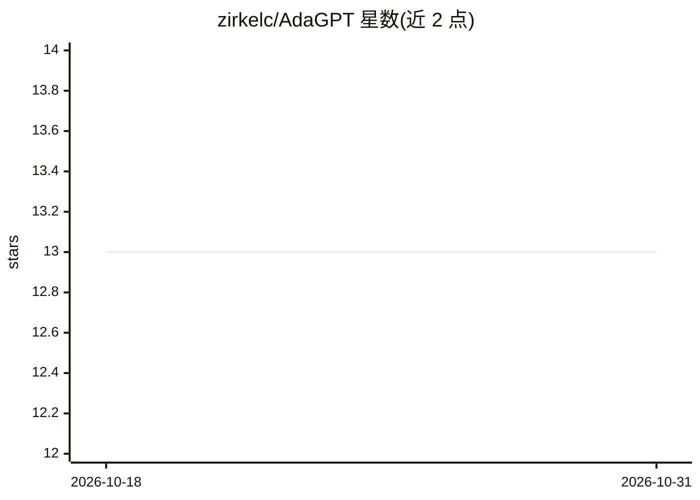

# zirkelc/AdaGPT

⭐ 13 · TypeScript · MIT · 推送 2026-06-26 · [GitHub](https://github.com/zirkelc/AdaGPT) · 个人维护

**GitHub Action：在 issue/PR 中 @AdaGPT 触发 AI 回复**

以 GitHub Action 形式提供的 AI 回复工具：在仓库的工作流中配置后，用户在 issue 或 PR 评论中提及 @AdaGPT 即触发，调用 OpenAI API（需自备 API key 并存为仓库 Secret）生成回复评论。支持配置 temperature、top_p、max_tokens 等采样参数，需要为 GITHUB_TOKEN 授予 issues:write 和 pull-requests:write 权限。未提及 @AdaGPT 时 Action 直接返回。示例包括解释 PR 内容等场景。

## 筛选速览

| 维度 | 判定 | 备注 |
|---|---|---|
| AI 角色 | `ai-native` | 本体是模型或模型工具 |
| 许可风险 | `permissive` | MIT |
| 部署形态 | `None` |  |
| 模型依赖 | — | README 未给出锁定关系 |
| 硬件要求 | — | 无带数字的原话,不猜 |
| 安装摩擦 | `low` | 无编译、无系统依赖或容器化 |
| 成熟度 | — | 结构信号不足 |

## 能力要点

- 评论中 @AdaGPT 触发，未提及时立即返回
- 通过 OpenAI API key（仓库 Secret）调用 chat completion
- 可配置 temperature / top_p / max_tokens 采样参数

## 适用场景

- 在 PR 下 @AdaGPT 让其解释代码变更
- 在 issue 讨论中获取 AI 生成的回复
- 团队无需离开 GitHub 即可获得 AI 辅助回应

## 场景标签

`聊天机器人` · 领域:对话与助手

## 证据(README 行号)

> L2: AdaGPT is an AI-powered GitHub Action that generates helpful responses to comments on issues and pull requests. It's
> L52: |`openai_key`|Yes||The API key used for OpenAI chat completion request. Go to OpenAI to create a new API key|

## 星数曲线

2026-10-18 13 → 2026-10-31 13（+0）

---
*卡片 v1 · prompt 1.4 · 生成 2026-10-31 · 置信度 high · 依据 README sha `e91633d1a03c` · [字段定义](../../DATASET.md)*
