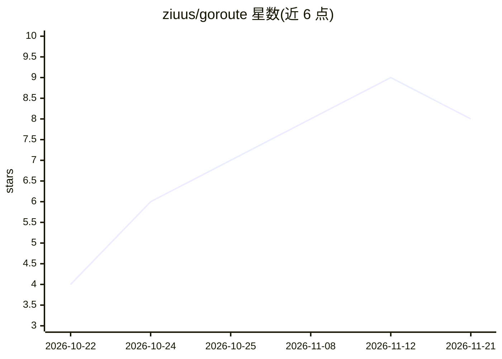

# ziuus/goroute

⭐ 8 · Go · MIT · 推送 2026-11-13 · [GitHub](https://github.com/ziuus/goroute) · [官网](https://goroute-website.vercel.app/) · 个人维护

**面向编码代理的单二进制 LLM 网关与多账户路由器**

Go 编写的单二进制 LLM 网关，部署在开发工具/编码代理与上游模型之间：聚合多个实验室与推理平台的账户，做流量均衡、协议转换（OpenAI Chat Completions、Anthropic Messages、Gemini 格式互桥）与自动故障转移；支持递归嵌套的 Combo 级联与 OAuth 账户池轮询。内嵌 Web 控制台（go:embed）提供提供商管理、级联编排与聊天测试。提供 npm、安装脚本、Homebrew、Go install、AUR 五种安装方式，声称零外部依赖。作者给出的基准数据（内存、延迟）为自测结果，采用时需自行验证。

## 筛选速览

| 维度 | 判定 | 备注 |
|---|---|---|
| AI 角色 | `ai-ecosystem` | LLM/agent 周边工具 |
| 许可风险 | `permissive` | MIT |
| 部署形态 | `library` | 以包/库形式分发 |
| 模型依赖 | local-ok | 支持本地模型 |
| 硬件要求 | — | 无带数字的原话,不猜 |
| 安装摩擦 | `low` | 无编译、无系统依赖或容器化 |
| 成熟度 | — | 结构信号不足 |

## 能力要点

- 单静态二进制，README 声称 <5 MB 空闲内存、零外部依赖
- 桥接 OpenAI / Anthropic / Gemini 三种协议格式
- 多账户 OAuth 池与 HTTP 429/宕机自动故障转移的 Combo 级联
- 一条命令为 Claude Code、Cursor、Codex、OpenCode 等 35 个工具生成配置

## 适用场景

- 为多个编码代理统一配置本地网关接入点
- 聚合多个上游账户做轮询与限流兜底
- 从 OmniRoute 迁移已有的账户池与级联配置

## 场景标签

`模型网关` · 领域:Agent 开发

## 证据(README 行号)

> L36: GoRoute is a single-binary LLM gateway engineered to sit between your developer tools, coding agents, and upstream 
> L44: - **Universal Protocol Translation**: Transparently bridges OpenAI Chat Completions, Anthropic Messages (`/v1/messa
> L174: goroute setup all        # Auto-configures all 35 supported developer tools

## 星数曲线

2026-10-22 4 → 2026-11-21 8（+4）

---
*卡片 v1 · prompt 1.4 · 生成 2026-11-20 · 置信度 high · 依据 README sha `536596077e16` · [字段定义](../../DATASET.md)*
