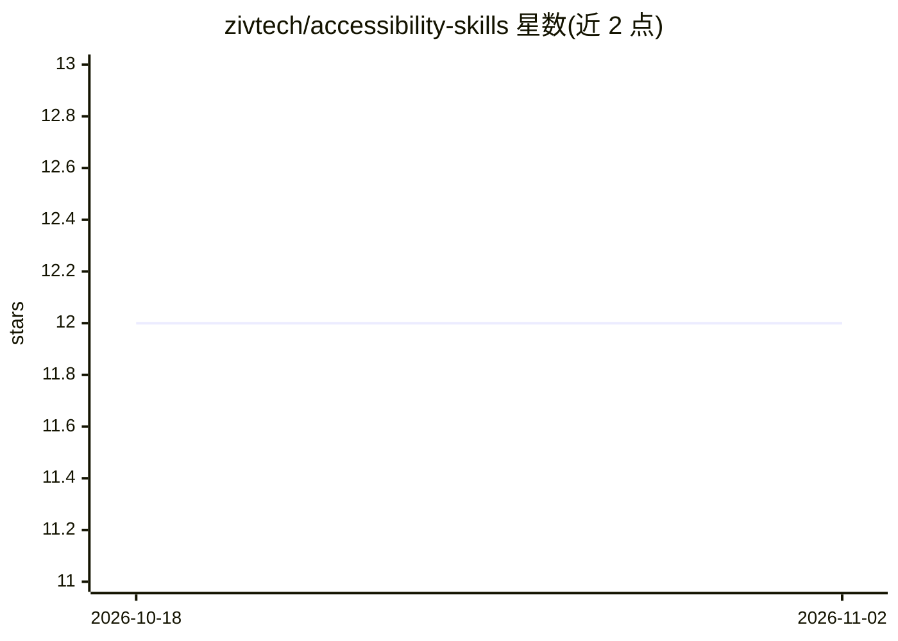

# zivtech/accessibility-skills

⭐ 12 · Python · GPL-3.0 · 推送 2026-10-23 · [GitHub](https://github.com/zivtech/accessibility-skills) · [官网](https://zivtech.github.io/accessibility-skills/) · 组织维护

**面向 Claude Code 的网页无障碍测试与 WCAG 2.2 审计技能集**

一套开源 AI agent 技能，安装到 Claude Code 后用于规划、测试、审查和审计网页无障碍：默认针对 WCAG 2.2 AA，支持 Revised Section 508。技能将真实浏览器测试（Playwright 键盘测试、axe-core 扫描、屏幕阅读器断言）与设计审查结合，产出开发者可复现的缺陷报告与 OpenACR 格式的草案 ACR（即 VPAT 类报告）。工具均以固定版本调用、不打包进仓库；自动结果视为线索而非判定，最终合规判断需人工签署。经 npx skills add 安装，另提供 Codex 格式副本与 Ollama 本地模型路径。

## 筛选速览

| 维度 | 判定 | 备注 |
|---|---|---|
| AI 角色 | `ai-ecosystem` | LLM/agent 周边工具 |
| 许可风险 | `viral` | GPL-3.0 |
| 部署形态 | `library` | 以包/库形式分发 |
| 模型依赖 | local-ok | 支持本地模型 |
| 硬件要求 | — | 无带数字的原话,不猜 |
| 安装摩擦 | `low` | 无编译、无系统依赖或容器化 |
| 成熟度 | `idea` | |

## 能力要点

- 覆盖规划→测试→审查全流程的 10+ 个技能命令（/a11y-workflow 等）
- 调用固定版本工具链：Playwright、axe-core、虚拟屏幕阅读器、pa11y-ci 等
- 生成 OpenACR 格式草案 ACR 与可复现缺陷报告
- 分析类技能可通过 Ollama 跑本地模型，附跨模型基准

## 适用场景

- 在开发阶段规划并测试可交互组件的键盘与 ARIA 行为
- 对站点执行 WCAG 2.2 AA / Section 508 审计并起草 ACR
- 把 axe-core 与键盘测试结果转成开发者可复现的缺陷工单

## 场景标签

`浏览器自动化` · 领域:效率与自动化

## 证据(README 行号)

> L1: # Accessibility Skills: AI accessibility testing and WCAG 2.2 audits for Claude Code
> L3: **Accessibility Skills** is an open-source set of AI agent skills that help Claude Code plan, test, review, and audi
> L36: |`/a11y-workflow`|Runs the whole accessibility lifecycle and hands each step to a specialist agent. Claude Code onl

## 星数曲线

2026-10-18 12 → 2026-11-02 12（+0）

---
*卡片 v1 · prompt 1.4 · 生成 2026-10-31 · 置信度 high · 依据 README sha `eb1d917c0e5d` · [字段定义](../../DATASET.md)*
