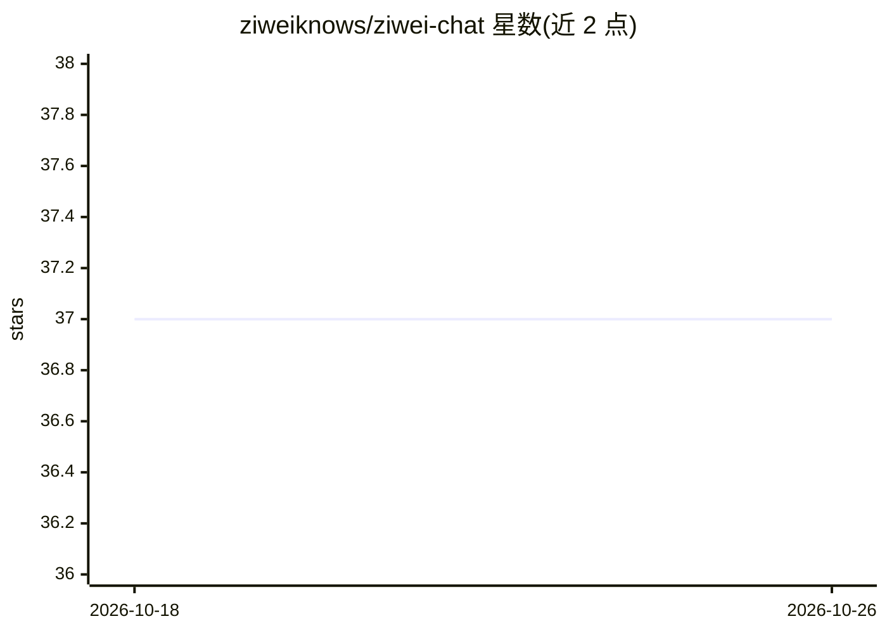

# ziweiknows/ziwei-chat

⭐ 37 · TypeScript · Apache-2.0 · 推送 2026-10-23 · [GitHub](https://github.com/ziweiknows/ziwei-chat) · [官网](https://ziweichat.vercel.app/) · 组织维护 · 中文 README

**开源紫微斗数对话 Agent：基于确定性排盘事实的可追溯问答**

面向普通用户的紫微斗数对话产品（Next.js 16 / React 19 / TypeScript）：用 iztro 确定性生成命盘，星曜与宫位不由模型计算；对话时结合本地 Markdown/关键词检索或可选 Embedding/pgvector 向量检索，回答附证据面板（工具调用、命盘事实、知识来源、critic 状态）。不要求注册，模型 API Key 仅存浏览器 localStorage，模型通过 OpenAI 兼容接口由用户自行配置；未配置模型时仍可排盘与本地检索。

## 筛选速览

| 维度 | 判定 | 备注 |
|---|---|---|
| AI 角色 | `ai-native` | 本体是模型或模型工具 |
| 许可风险 | `permissive` | Apache-2.0 |
| 部署形态 | `self-host` | docker 或自建部署 |
| 模型依赖 | — | README 未给出锁定关系 |
| 硬件要求 | — | 无带数字的原话,不猜 |
| 安装摩擦 | `low` | 无编译、无系统依赖或容器化 |
| 成熟度 | — | 结构信号不足 |

## 能力要点

- iztro 确定性排盘，模型不自行计算星曜宫位
- 每次分析可查看工具调用、命盘事实与知识来源的证据面板
- 无数据库可用本地模式；可选 Postgres/pgvector 持久化与向量检索
- API Key 仅存浏览器 localStorage，按需生成宫位解读以控制 Token 消耗

## 适用场景

- 生成个人命盘并围绕事业、关系、财富等问题对话追问
- 查看每次回答背后的命盘事实与知识来源
- 本地无数据库环境下的匿名命盘与对话使用

## 场景标签

`聊天机器人` · 领域:对话与助手

## 证据(README 行号)

> L35: **Ziwei Chat** 是一个消费级紫微斗数对话产品。你可以创建自己的命盘，和「知微」聊事业、关系、财富、近况，也可以从任何你真正关心的问题开始。
> L39: 「知微」不是用固定报告模板回答问题。她会自然地和你对谈，但涉及个人命盘时，只会把确定性排盘工具给出的信息当作你的盘面事实。
> L45: |**确定性排盘**|使用 iztro 生成命盘，不让模型自行计算星曜或宫位。|

## 星数曲线

2026-10-18 37 → 2026-10-26 37（+0）

---
*卡片 v1 · prompt 1.4 · 生成 2026-10-25 · 置信度 mid · 依据 README sha `8457f24adbcd` · [字段定义](../../DATASET.md)*
